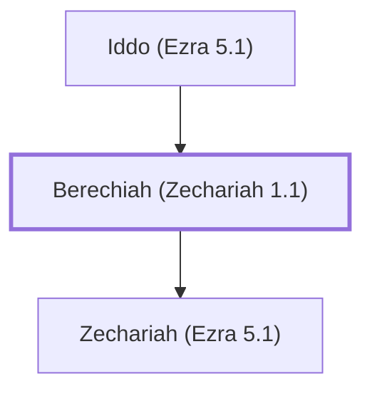

# Berechiah (Zechariah 1.1)

Father of the prophet Zechariah

**Original-language names:** בֶּרֶכְיָה (H1296)

## When

- **Placed around:** [[connections/timeline/6th century BC|519 BC]] *(Ussher: the median date of the passages naming them)*

## Family

- **Father:** [[connections/people/Iddo (Ezra 5.1)|Iddo (Ezra 5.1)]]
- **Children:** [[connections/people/Zechariah (Ezra 5.1)|Zechariah (Ezra 5.1)]]

**Family group:** [[connections/genealogy/Family of Iddo (Ezra 5.1)|Family of Iddo (Ezra 5.1)]], generation 2

## Appears in

[[connections/chapters/38-zechariah/Zechariah 1|Zechariah 1 (2)]]

## Appears in the same verse as

[[connections/people/Darius (Ezra 4.5)|Darius (Ezra 4.5) (2)]] · [[connections/people/Iddo (Ezra 5.1)|Iddo (Ezra 5.1) (2)]] · [[connections/people/Zechariah (Ezra 5.1)|Zechariah (Ezra 5.1) (2)]]
