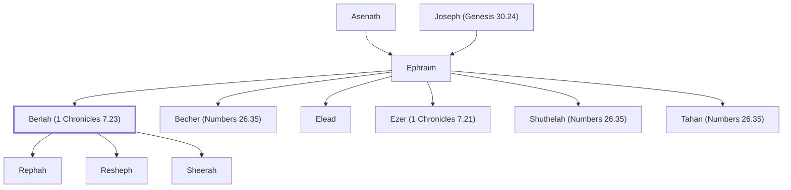

# Beriah (1 Chronicles 7.23)

Son of Ephraim born after family tragedy

**Original-language names:** בְּרִיעָה (H1283)

## Family

- **Father:** [[connections/people/Ephraim|Ephraim]]
- **Brothers and sisters:** [[connections/people/Becher (Numbers 26.35)|Becher (Numbers 26.35)]], [[connections/people/Elead|Elead]], [[connections/people/Ezer (1 Chronicles 7.21)|Ezer (1 Chronicles 7.21)]], [[connections/people/Shuthelah (Numbers 26.35)|Shuthelah (Numbers 26.35)]], [[connections/people/Tahan (Numbers 26.35)|Tahan (Numbers 26.35)]]
- **Children:** [[connections/people/Rephah|Rephah]], [[connections/people/Resheph|Resheph]], [[connections/people/Sheerah|Sheerah]]
- **Tribe or nation:** Tribe of Ephraim

**Line of descent** (26 generations, father to son): [[connections/people/Adam|Adam]] → [[connections/people/Seth|Seth]] → [[connections/people/Enosh|Enosh]] → [[connections/people/Kenan|Kenan]] → [[connections/people/Mahalalel (Genesis 5.12)|Mahalalel (Genesis 5.12)]] → [[connections/people/Jared|Jared]] → [[connections/people/Enoch (Genesis 5.18)|Enoch (Genesis 5.18)]] → [[connections/people/Methuselah|Methuselah]] → [[connections/people/Lamech (Genesis 5.25)|Lamech (Genesis 5.25)]] → [[connections/people/Noah (Genesis 5.29)|Noah (Genesis 5.29)]] → [[connections/people/Shem|Shem]] → [[connections/people/Arpachshad|Arpachshad]] → [[connections/people/Cainan|Cainan]] → [[connections/people/Shelah (Genesis 10.24)|Shelah (Genesis 10.24)]] → [[connections/people/Eber (Genesis 10.21)|Eber (Genesis 10.21)]] → [[connections/people/Peleg|Peleg]] → [[connections/people/Reu|Reu]] → [[connections/people/Serug|Serug]] → [[connections/people/Nahor (Genesis 11.22)|Nahor (Genesis 11.22)]] → [[connections/people/Terah|Terah]] → [[connections/people/Abraham|Abraham]] → [[connections/people/Isaac|Isaac]] → [[connections/people/Israel|Israel]] → [[connections/people/Joseph (Genesis 30.24)|Joseph (Genesis 30.24)]] → [[connections/people/Ephraim|Ephraim]] → **Beriah (1 Chronicles 7.23)**

**Family group:** [[connections/genealogy/Family of Adam|Family of Adam]], generation 26

## Appears in

[[connections/chapters/13-1-chronicles/1 Chronicles 7|1 Chronicles 7]]
