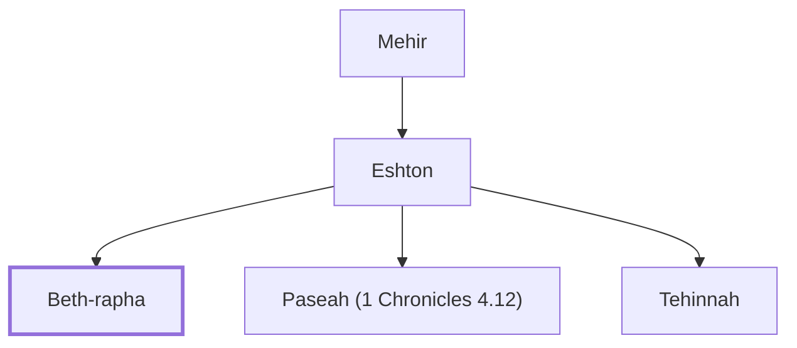

# Beth-rapha

Descendant of Judah through Eshton

**Original-language names:** בֵּית רָפָא (H1051)

## When

- **Placed around:** [[connections/timeline/18th century BC|1721 BC]] *(Ussher: the median date of the passages naming them)*

## Family

- **Father:** [[connections/people/Eshton|Eshton]]
- **Brothers and sisters:** [[connections/people/Paseah (1 Chronicles 4.12)|Paseah (1 Chronicles 4.12)]], [[connections/people/Tehinnah|Tehinnah]]
- **Tribe or nation:** Tribe of Judah

**Line of descent** (4 generations, father to son): [[connections/people/Chelub (1 Chronicles 4.11)|Chelub (1 Chronicles 4.11)]] → [[connections/people/Mehir|Mehir]] → [[connections/people/Eshton|Eshton]] → **Beth-rapha**

**Family group:** [[connections/genealogy/Family of Chelub (1 Chronicles 4.11)|Family of Chelub (1 Chronicles 4.11)]], generation 4

## Appears in

[[connections/chapters/13-1-chronicles/1 Chronicles 4|1 Chronicles 4]]

## Appears in the same verse as

[[connections/people/Eshton|Eshton]] · [[connections/people/Paseah (1 Chronicles 4.12)|Paseah (1 Chronicles 4.12)]] · [[connections/people/Tehinnah|Tehinnah]] · [[connections/places/Ir-nahash|Ir-nahash]] · [[connections/places/Recah|Recah]]
