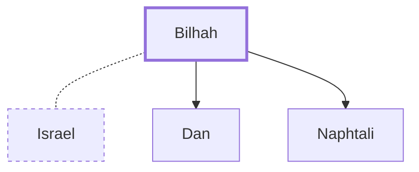

# Bilhah

Rachel's maidservant and mother of Dan and Naphtali

**Original-language names:** בִּלְהָה (H1090a)

## When

- **Placed around:** [[connections/timeline/18th century BC|1729 BC]] *(Ussher: the median date of the passages naming them)*

## Family

- **Spouses:** [[connections/people/Israel|Israel]]
- **Children:** [[connections/people/Dan|Dan]], [[connections/people/Naphtali|Naphtali]]

**Family group:** [[connections/genealogy/Family of Adam|Family of Adam]], generation 25

## Events

- [[connections/timeline/18th century BC|1755 BC]] · [[connections/events/Birth of Dan|Birth of Dan]]
- [[connections/timeline/18th century BC|1754 BC]] · [[connections/events/Birth of Naphtali|Birth of Naphtali]]

## Appears in

[[connections/chapters/01-genesis/Genesis 29|Genesis 29]] · [[connections/chapters/01-genesis/Genesis 30|Genesis 30 (4)]] · [[connections/chapters/01-genesis/Genesis 35|Genesis 35 (2)]] · [[connections/chapters/01-genesis/Genesis 37|Genesis 37]] · [[connections/chapters/01-genesis/Genesis 46|Genesis 46]] · [[connections/chapters/13-1-chronicles/1 Chronicles 7|1 Chronicles 7]]

## Appears in the same verse as

[[connections/people/Israel|Israel (6)]] · [[connections/people/Rachel|Rachel (4)]] · [[connections/people/Laban|Laban (2)]] · [[connections/people/Naphtali|Naphtali (2)]] · [[connections/people/Dan|Dan]] · [[connections/people/Guni (Genesis 46.24)|Guni (Genesis 46.24)]] · [[connections/people/Jahzeel|Jahzeel]] · [[connections/people/Jezer|Jezer]] · [[connections/people/Joseph (Genesis 30.24)|Joseph (Genesis 30.24)]] · [[connections/people/Reuben|Reuben]] · [[connections/people/Shillem|Shillem]] · [[connections/people/Zilpah|Zilpah]]
