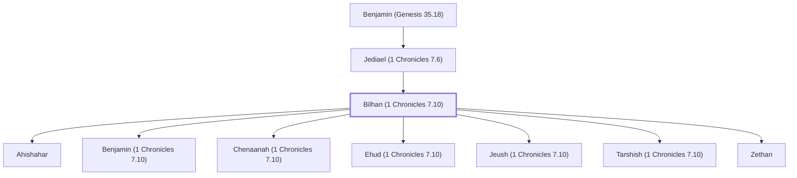

# Bilhan (1 Chronicles 7.10)

Benjamite, son of Jediael and father of seven sons

**Original-language names:** בִּלְהָן (H1092)

## Family

- **Father:** [[connections/people/Jediael (1 Chronicles 7.6)|Jediael (1 Chronicles 7.6)]]
- **Children:** [[connections/people/Ahishahar|Ahishahar]], [[connections/people/Benjamin (1 Chronicles 7.10)|Benjamin (1 Chronicles 7.10)]], [[connections/people/Chenaanah (1 Chronicles 7.10)|Chenaanah (1 Chronicles 7.10)]], [[connections/people/Ehud (1 Chronicles 7.10)|Ehud (1 Chronicles 7.10)]], [[connections/people/Jeush (1 Chronicles 7.10)|Jeush (1 Chronicles 7.10)]], [[connections/people/Tarshish (1 Chronicles 7.10)|Tarshish (1 Chronicles 7.10)]], [[connections/people/Zethan|Zethan]]
- **Tribe or nation:** Tribe of Benjamin

**Line of descent** (26 generations, father to son): [[connections/people/Adam|Adam]] → [[connections/people/Seth|Seth]] → [[connections/people/Enosh|Enosh]] → [[connections/people/Kenan|Kenan]] → [[connections/people/Mahalalel (Genesis 5.12)|Mahalalel (Genesis 5.12)]] → [[connections/people/Jared|Jared]] → [[connections/people/Enoch (Genesis 5.18)|Enoch (Genesis 5.18)]] → [[connections/people/Methuselah|Methuselah]] → [[connections/people/Lamech (Genesis 5.25)|Lamech (Genesis 5.25)]] → [[connections/people/Noah (Genesis 5.29)|Noah (Genesis 5.29)]] → [[connections/people/Shem|Shem]] → [[connections/people/Arpachshad|Arpachshad]] → [[connections/people/Cainan|Cainan]] → [[connections/people/Shelah (Genesis 10.24)|Shelah (Genesis 10.24)]] → [[connections/people/Eber (Genesis 10.21)|Eber (Genesis 10.21)]] → [[connections/people/Peleg|Peleg]] → [[connections/people/Reu|Reu]] → [[connections/people/Serug|Serug]] → [[connections/people/Nahor (Genesis 11.22)|Nahor (Genesis 11.22)]] → [[connections/people/Terah|Terah]] → [[connections/people/Abraham|Abraham]] → [[connections/people/Isaac|Isaac]] → [[connections/people/Israel|Israel]] → [[connections/people/Benjamin (Genesis 35.18)|Benjamin (Genesis 35.18)]] → [[connections/people/Jediael (1 Chronicles 7.6)|Jediael (1 Chronicles 7.6)]] → **Bilhan (1 Chronicles 7.10)**

**Family group:** [[connections/genealogy/Family of Adam|Family of Adam]], generation 26

## Appears in

[[connections/chapters/13-1-chronicles/1 Chronicles 7|1 Chronicles 7]]

## Appears in the same verse as

[[connections/people/Ahishahar|Ahishahar]] · [[connections/people/Benjamin (1 Chronicles 7.10)|Benjamin (1 Chronicles 7.10)]] · [[connections/people/Chenaanah (1 Chronicles 7.10)|Chenaanah (1 Chronicles 7.10)]] · [[connections/people/Ehud (1 Chronicles 7.10)|Ehud (1 Chronicles 7.10)]] · [[connections/people/Jediael (1 Chronicles 7.6)|Jediael (1 Chronicles 7.6)]] · [[connections/people/Jeush (1 Chronicles 7.10)|Jeush (1 Chronicles 7.10)]] · [[connections/people/Tarshish (1 Chronicles 7.10)|Tarshish (1 Chronicles 7.10)]] · [[connections/people/Zethan|Zethan]]
