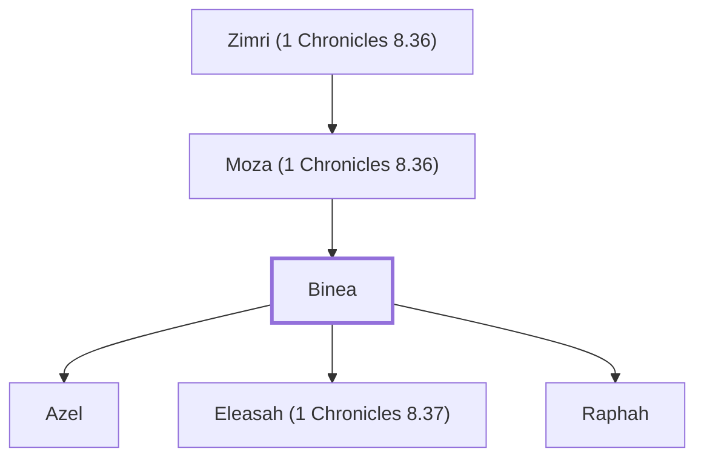

# Binea

Descendant of King Saul and Jonathan

**Original-language names:** בִּנְעָא (H1150)

## When

- **Placed around:** [[connections/timeline/12th century BC|1200 BC]] *(Ussher: the median date of the passages naming them)*

## Family

- **Father:** [[connections/people/Moza (1 Chronicles 8.36)|Moza (1 Chronicles 8.36)]]
- **Children:** [[connections/people/Azel|Azel]], [[connections/people/Eleasah (1 Chronicles 8.37)|Eleasah (1 Chronicles 8.37)]], [[connections/people/Raphah|Raphah]]
- **Tribe or nation:** Tribe of Benjamin

**Line of descent** (14 generations, father to son): [[connections/people/Aphiah|Aphiah]] → [[connections/people/Becorath|Becorath]] → [[connections/people/Zeror|Zeror]] → [[connections/people/Abiel|Abiel]] → [[connections/people/Kish (1 Samuel 9.1)|Kish (1 Samuel 9.1)]] → [[connections/people/Saul|Saul]] → [[connections/people/Jonathan (1 Samuel 13.2)|Jonathan (1 Samuel 13.2)]] → [[connections/people/Mephibosheth (2 Samuel 4.4)|Mephibosheth (2 Samuel 4.4)]] → [[connections/people/Micah (2 Samuel 9.12)|Micah (2 Samuel 9.12)]] → [[connections/people/Ahaz (1 Chronicles 8.35)|Ahaz (1 Chronicles 8.35)]] → [[connections/people/Jehoaddah|Jehoaddah]] → [[connections/people/Zimri (1 Chronicles 8.36)|Zimri (1 Chronicles 8.36)]] → [[connections/people/Moza (1 Chronicles 8.36)|Moza (1 Chronicles 8.36)]] → **Binea**

**Family group:** [[connections/genealogy/Family of Aphiah|Family of Aphiah]], generation 14

## Appears in

[[connections/chapters/13-1-chronicles/1 Chronicles 8|1 Chronicles 8]] · [[connections/chapters/13-1-chronicles/1 Chronicles 9|1 Chronicles 9]]

## Appears in the same verse as

[[connections/people/Azel|Azel (2)]] · [[connections/people/Eleasah (1 Chronicles 8.37)|Eleasah (1 Chronicles 8.37) (2)]] · [[connections/people/Moza (1 Chronicles 8.36)|Moza (1 Chronicles 8.36) (2)]] · [[connections/people/Raphah|Raphah (2)]]
