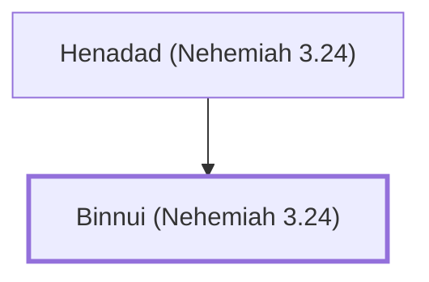

# Binnui (Nehemiah 3.24)

Levite who repaired a section of Jerusalem's wall

**Original-language names:** בִּנּוּי (H1131)

## When

- **Placed around:** [[connections/timeline/5th century BC|445 BC]] *(Ussher: the median date of the passages naming them)*

## Family

- **Father:** [[connections/people/Henadad (Nehemiah 3.24)|Henadad (Nehemiah 3.24)]]

**Family group:** [[connections/genealogy/Family of Henadad (Nehemiah 3.24)|Family of Henadad (Nehemiah 3.24)]], generation 2

## Appears in

[[connections/chapters/16-nehemiah/Nehemiah 3|Nehemiah 3]]

## Appears in the same verse as

[[connections/people/Azariah (Nehemiah 3.23)|Azariah (Nehemiah 3.23)]] · [[connections/people/Henadad (Nehemiah 3.24)|Henadad (Nehemiah 3.24)]]
