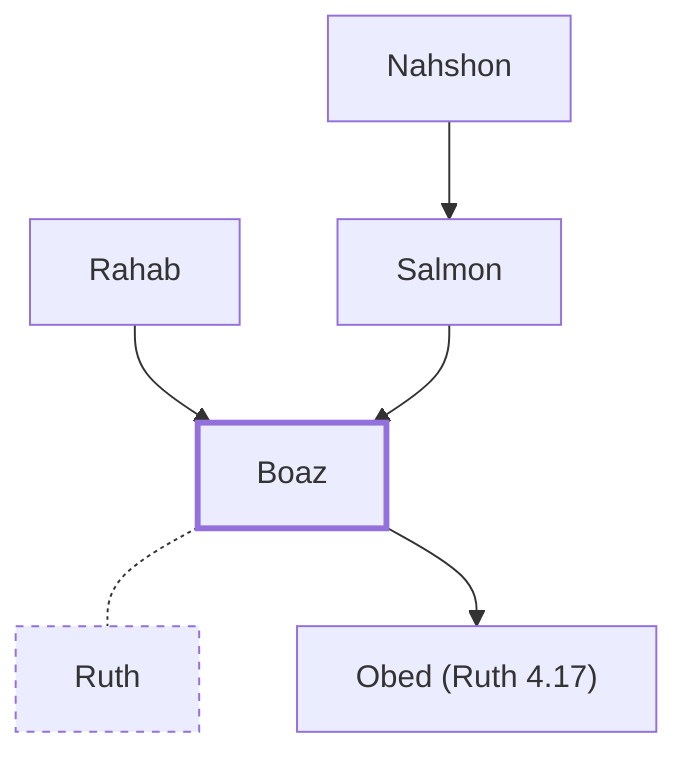

# Boaz

Kinsman-redeemer who married Ruth, ancestor of David and Jesus

**Original-language names:** בֹּ֫עַז (H1162) · Βοόζ (G1003)

## When

- **Placed around:** [[connections/timeline/14th century BC|1307 BC]] *(Ussher: the median date of the passages naming them)*

## Family

- **Father:** [[connections/people/Salmon|Salmon]]
- **Mother:** [[connections/people/Rahab|Rahab (uncertain, descendants)]]
- **Spouses:** [[connections/people/Ruth|Ruth]]
- **Children:** [[connections/people/Obed (Ruth 4.17)|Obed (Ruth 4.17)]]
- **Tribe or nation:** Tribe of Judah

**Line of descent** (31 generations, father to son): [[connections/people/Adam|Adam]] → [[connections/people/Seth|Seth]] → [[connections/people/Enosh|Enosh]] → [[connections/people/Kenan|Kenan]] → [[connections/people/Mahalalel (Genesis 5.12)|Mahalalel (Genesis 5.12)]] → [[connections/people/Jared|Jared]] → [[connections/people/Enoch (Genesis 5.18)|Enoch (Genesis 5.18)]] → [[connections/people/Methuselah|Methuselah]] → [[connections/people/Lamech (Genesis 5.25)|Lamech (Genesis 5.25)]] → [[connections/people/Noah (Genesis 5.29)|Noah (Genesis 5.29)]] → [[connections/people/Shem|Shem]] → [[connections/people/Arpachshad|Arpachshad]] → [[connections/people/Cainan|Cainan]] → [[connections/people/Shelah (Genesis 10.24)|Shelah (Genesis 10.24)]] → [[connections/people/Eber (Genesis 10.21)|Eber (Genesis 10.21)]] → [[connections/people/Peleg|Peleg]] → [[connections/people/Reu|Reu]] → [[connections/people/Serug|Serug]] → [[connections/people/Nahor (Genesis 11.22)|Nahor (Genesis 11.22)]] → [[connections/people/Terah|Terah]] → [[connections/people/Abraham|Abraham]] → [[connections/people/Isaac|Isaac]] → [[connections/people/Israel|Israel]] → [[connections/people/Judah (Genesis 29.35)|Judah (Genesis 29.35)]] → [[connections/people/Perez|Perez]] → [[connections/people/Hezron (Genesis 46.12)|Hezron (Genesis 46.12)]] → [[connections/people/Ram (Ruth 4.19)|Ram (Ruth 4.19)]] → [[connections/people/Amminadab (Exodus 6.23)|Amminadab (Exodus 6.23)]] → [[connections/people/Nahshon|Nahshon]] → [[connections/people/Salmon|Salmon]] → **Boaz**

**Family group:** [[connections/genealogy/Family of Adam|Family of Adam]], generation 31

## Appears in

[[connections/chapters/08-ruth/Ruth 2|Ruth 2 (10)]] · [[connections/chapters/08-ruth/Ruth 3|Ruth 3 (2)]] · [[connections/chapters/08-ruth/Ruth 4|Ruth 4 (6)]] · [[connections/chapters/13-1-chronicles/1 Chronicles 2|1 Chronicles 2 (2)]] · [[connections/chapters/40-matthew/Matthew 1|Matthew 1]] · [[connections/chapters/42-luke/Luke 3|Luke 3]]

## Appears in the same verse as

[[connections/people/Obed (Ruth 4.17)|Obed (Ruth 4.17) (4)]] · [[connections/people/Ruth|Ruth (4)]] · [[connections/people/Salmon|Salmon (4)]] · [[connections/people/Elimelech|Elimelech (3)]] · [[connections/people/Jesse|Jesse (3)]] · [[connections/people/Naomi|Naomi (3)]] · [[connections/people/Nahshon|Nahshon (2)]] · [[connections/people/Chilion|Chilion]] · [[connections/people/Mahlon|Mahlon]] · [[connections/people/Rahab|Rahab]] · [[connections/places/Bethlehem (Genesis 35.16)|Bethlehem (Genesis 35.16)]] · [[connections/places/Moab|Moab]]
