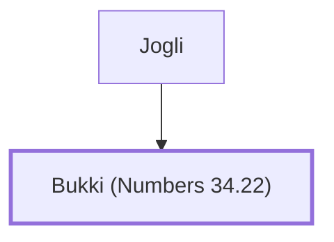

# Bukki (Numbers 34.22)

Son of Jogli, a prince of Dan

**Original-language names:** בֻּקִּי (H1231)

## When

- **Placed around:** [[connections/timeline/15th century BC|1452 BC]] *(Ussher: the median date of the passages naming them)*

## Family

- **Father:** [[connections/people/Jogli|Jogli]]

**Family group:** [[connections/genealogy/Family of Jogli|Family of Jogli]], generation 2

## Appears in

[[connections/chapters/04-numbers/Numbers 34|Numbers 34]]

## Appears in the same verse as

[[connections/people/Jogli|Jogli]] · [[connections/places/Dan|Dan]]
