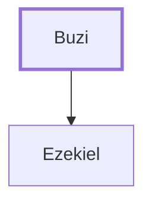

# Buzi

Father of Ezekiel the prophet

**Original-language names:** בּוּזִי (H0941)

## When

- **Placed around:** [[connections/timeline/6th century BC|595 BC]] *(Ussher: the median date of the passages naming them)*

## Family

- **Children:** [[connections/people/Ezekiel|Ezekiel]]

**Family group:** [[connections/genealogy/Family of Buzi|Family of Buzi]], generation 1

## Appears in

[[connections/chapters/26-ezekiel/Ezekiel 1|Ezekiel 1]]

## Appears in the same verse as

[[connections/people/Ezekiel|Ezekiel]] · [[connections/places/Chaldea|Chaldea]] · [[connections/places/Chebar|Chebar]]
