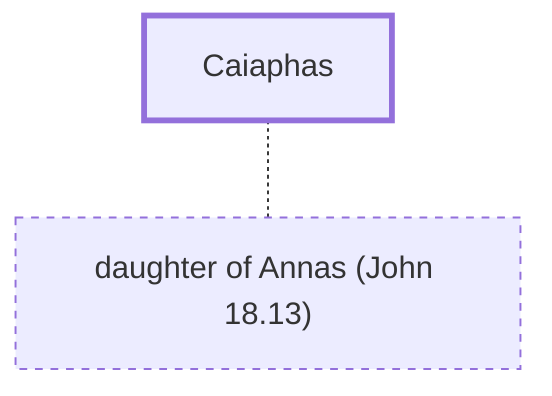

# Caiaphas

High priest during Jesus' ministry and trial

**Original-language names:** Καϊάφας (G2533)

## When

- **Placed around:** [[connections/timeline/1st century AD|AD 33]] *(Ussher: the median date of the passages naming them)*
- **Reigned / in office:** [[connections/timeline/1st century AD|AD 18]] – [[connections/timeline/1st century AD|AD 36]] *(modern dates)* · Caiaphas, High priests · [Wikidata Q211246](https://www.wikidata.org/wiki/Q211246)

## Family

- **Spouses:** [[connections/people/daughter of Annas (John 18.13)|daughter of Annas (John 18.13)]]
- **Tribe or nation:** Tribe of Levi

## Events

- [[connections/timeline/1st century AD|AD 30]] · [[connections/events/Sanhedrin Conspiracy|Sanhedrin Conspiracy]]
- [[connections/timeline/1st century AD|AD 30]] · [[connections/events/Jewish Trials|Jewish Trials]]
- [[connections/timeline/1st century AD|AD 30]] · [[connections/events/Chief Priests Conspire Against Jesus|Chief Priests Conspire Against Jesus]]
- [[connections/timeline/1st century AD|AD 30]] · [[connections/events/Peter and John's Trial|Peter and John's Trial]]

## Appears in

[[connections/chapters/40-matthew/Matthew 26|Matthew 26 (2)]] · [[connections/chapters/42-luke/Luke 3|Luke 3]] · [[connections/chapters/43-john/John 11|John 11]] · [[connections/chapters/43-john/John 18|John 18 (4)]] · [[connections/chapters/44-acts/Acts 4|Acts 4]]

## Appears in the same verse as

[[connections/people/Annas|Annas (4)]] · [[connections/people/Jesus|Jesus (2)]] · [[connections/people/Alexander (Acts 4.6)|Alexander (Acts 4.6)]] · [[connections/people/John (Acts 4.6)|John (Acts 4.6)]] · [[connections/people/John (Matthew 3.1)|John (Matthew 3.1)]] · [[connections/people/Zechariah (Luke 1.5)|Zechariah (Luke 1.5)]]
