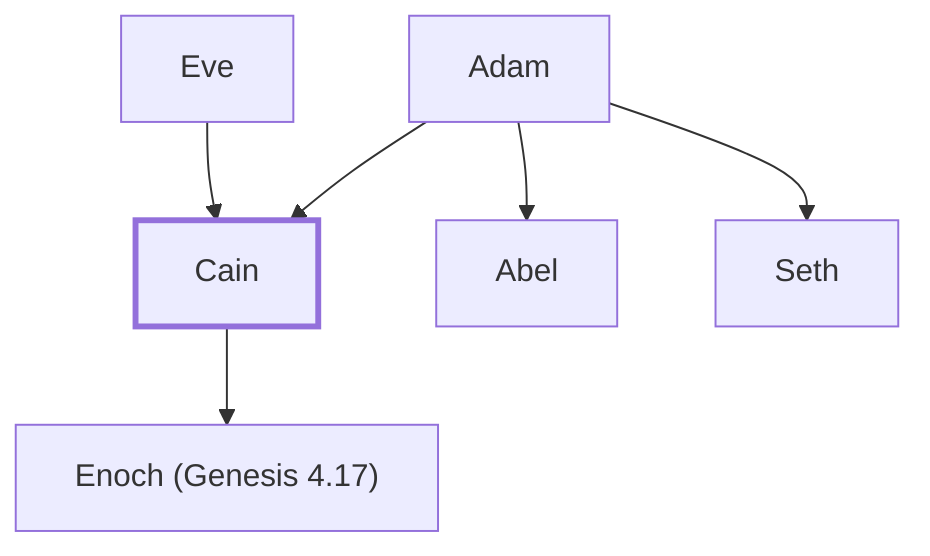

# Cain

Adam and Eve's firstborn son, killed his brother Abel

**Original-language names:** קַ֫יִן (H7014b) · Κάϊν (G2535)

## When

- **Lived:** [[connections/timeline/41st century BC|4003 BC]] – ? *(Jones)*
- **Placed around:** [[connections/timeline/41st century BC|4003 BC]] *(Ussher: the median date of the passages naming them)*

## Family

- **Father:** [[connections/people/Adam|Adam]]
- **Mother:** [[connections/people/Eve|Eve]]
- **Brothers and sisters:** [[connections/people/Abel|Abel]], [[connections/people/Seth|Seth]]
- **Children:** [[connections/people/Enoch (Genesis 4.17)|Enoch (Genesis 4.17)]]
- **Tribe or nation:** Early Patriarch

**Family group:** [[connections/genealogy/Family of Adam|Family of Adam]], generation 2

## Events

- [[connections/timeline/39th century BC|3875 BC]] · [[connections/events/Cain kills Abel|Cain kills Abel]]
- [[connections/timeline/39th century BC|3875 BC]] · [[connections/events/God curses Cain|God curses Cain]]

## Appears in

[[connections/chapters/01-genesis/Genesis 4|Genesis 4 (13)]] · [[connections/chapters/58-hebrews/Hebrews 11|Hebrews 11]] · [[connections/chapters/62-1-john/1 John 3|1 John 3]] · [[connections/chapters/65-jude/Jude 1|Jude 1]]

## Appears in the same verse as

[[connections/people/Abel|Abel (5)]] · [[connections/people/Adam|Adam (2)]] · [[connections/people/Balaam|Balaam]] · [[connections/people/Enoch (Genesis 4.17)|Enoch (Genesis 4.17)]] · [[connections/people/Eve|Eve]] · [[connections/people/Korah (Exodus 6.21)|Korah (Exodus 6.21)]] · [[connections/people/Lamech (Genesis 4.18)|Lamech (Genesis 4.18)]] · [[connections/people/Seth|Seth]] · [[connections/places/Eden (Genesis 2.8)|Eden (Genesis 2.8)]] · [[connections/places/Nod|Nod]]
