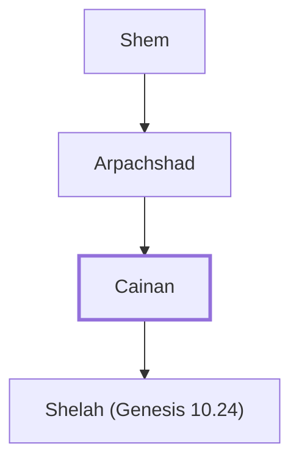

# Cainan

Son of Arphaxad, ancestor of Jesus (Luke's genealogy)

**Original-language names:** Καϊνάν, Καϊνάμ (G2536)

## When

- **Placed around:** [[connections/timeline/1st century AD|AD 26]] *(Ussher: the median date of the passages naming them)*

## Family

- **Father:** [[connections/people/Arpachshad|Arpachshad]]
- **Children:** [[connections/people/Shelah (Genesis 10.24)|Shelah (Genesis 10.24)]]
- **Tribe or nation:** Early Patriarch

**Line of descent** (13 generations, father to son): [[connections/people/Adam|Adam]] → [[connections/people/Seth|Seth]] → [[connections/people/Enosh|Enosh]] → [[connections/people/Kenan|Kenan]] → [[connections/people/Mahalalel (Genesis 5.12)|Mahalalel (Genesis 5.12)]] → [[connections/people/Jared|Jared]] → [[connections/people/Enoch (Genesis 5.18)|Enoch (Genesis 5.18)]] → [[connections/people/Methuselah|Methuselah]] → [[connections/people/Lamech (Genesis 5.25)|Lamech (Genesis 5.25)]] → [[connections/people/Noah (Genesis 5.29)|Noah (Genesis 5.29)]] → [[connections/people/Shem|Shem]] → [[connections/people/Arpachshad|Arpachshad]] → **Cainan**

**Family group:** [[connections/genealogy/Family of Adam|Family of Adam]], generation 13

## Appears in

[[connections/chapters/42-luke/Luke 3|Luke 3]]

## Appears in the same verse as

[[connections/people/Arpachshad|Arpachshad]] · [[connections/people/Lamech (Genesis 5.25)|Lamech (Genesis 5.25)]] · [[connections/people/Noah (Genesis 5.29)|Noah (Genesis 5.29)]] · [[connections/people/Shem|Shem]]
