# Caleb (1 Chronicles 2.9)

Son of Hezron, descendant of Judah

**Also called:** Carmi, Chelubai

**Original-language names:** כָּלֵב (H3612) · כַּרְמִי (H3756) · כְּלוּבָ֑י (H3621)

## When

- **Placed around:** [[connections/timeline/15th century BC|1470 BC]] *(Ussher: the median date of the passages naming them)*

## Family

- **Father:** [[connections/people/Hezron (Genesis 46.12)|Hezron (Genesis 46.12)]]
- **Mother:** [[connections/people/a wife of Hezron (1 Chronicles 2.9)|a wife of Hezron (1 Chronicles 2.9) (uncertain)]]
- **Brothers and sisters:** [[connections/people/Ashhur|Ashhur]], [[connections/people/Jerahmeel (1 Chronicles 2.9)|Jerahmeel (1 Chronicles 2.9)]], [[connections/people/Ram (Ruth 4.19)|Ram (Ruth 4.19)]], [[connections/people/Segub (1 Chronicles 2.21)|Segub (1 Chronicles 2.21)]]
- **Spouses:** [[connections/people/Azubah (1 Chronicles 2.18)|Azubah (1 Chronicles 2.18)]], [[connections/people/Ephah (1 Chronicles 2.46)|Ephah (1 Chronicles 2.46)]], [[connections/people/Ephrathah|Ephrathah]], [[connections/people/Jahdai|Jahdai (uncertain)]], [[connections/people/Jerioth|Jerioth]], [[connections/people/Maacah (1 Chronicles 2.48)|Maacah (1 Chronicles 2.48)]]
- **Children:** [[connections/people/Achsah (1 Chronicles 2.49)|Achsah (1 Chronicles 2.49)]], [[connections/people/Ardon|Ardon]], [[connections/people/Ephah (1 Chronicles 2.47)|Ephah (1 Chronicles 2.47)]], [[connections/people/Gazez (1 Chronicles 2.46)|Gazez (1 Chronicles 2.46)]], [[connections/people/Geshan|Geshan]], [[connections/people/Haran (1 Chronicles 2.46)|Haran (1 Chronicles 2.46)]], [[connections/people/Hur (Exodus 17.10)|Hur (Exodus 17.10)]], [[connections/people/Jesher|Jesher]], [[connections/people/Jotham (1 Chronicles 2.47)|Jotham (1 Chronicles 2.47)]], [[connections/people/Mesha (1 Chronicles 2.42)|Mesha (1 Chronicles 2.42)]], [[connections/people/Moza (1 Chronicles 2.46)|Moza (1 Chronicles 2.46)]], [[connections/people/Pelet (1 Chronicles 2.47)|Pelet (1 Chronicles 2.47)]], [[connections/people/Regem|Regem]], [[connections/people/Shaaph (1 Chronicles 2.47)|Shaaph (1 Chronicles 2.47)]], [[connections/people/Shaaph (1 Chronicles 2.49)|Shaaph (1 Chronicles 2.49)]], [[connections/people/Sheber|Sheber]], [[connections/people/Sheva|Sheva]], [[connections/people/Shobab (1 Chronicles 2.18)|Shobab (1 Chronicles 2.18)]], [[connections/people/Tirhanah|Tirhanah]]
- **Tribe or nation:** Tribe of Judah

**Line of descent** (27 generations, father to son): [[connections/people/Adam|Adam]] → [[connections/people/Seth|Seth]] → [[connections/people/Enosh|Enosh]] → [[connections/people/Kenan|Kenan]] → [[connections/people/Mahalalel (Genesis 5.12)|Mahalalel (Genesis 5.12)]] → [[connections/people/Jared|Jared]] → [[connections/people/Enoch (Genesis 5.18)|Enoch (Genesis 5.18)]] → [[connections/people/Methuselah|Methuselah]] → [[connections/people/Lamech (Genesis 5.25)|Lamech (Genesis 5.25)]] → [[connections/people/Noah (Genesis 5.29)|Noah (Genesis 5.29)]] → [[connections/people/Shem|Shem]] → [[connections/people/Arpachshad|Arpachshad]] → [[connections/people/Cainan|Cainan]] → [[connections/people/Shelah (Genesis 10.24)|Shelah (Genesis 10.24)]] → [[connections/people/Eber (Genesis 10.21)|Eber (Genesis 10.21)]] → [[connections/people/Peleg|Peleg]] → [[connections/people/Reu|Reu]] → [[connections/people/Serug|Serug]] → [[connections/people/Nahor (Genesis 11.22)|Nahor (Genesis 11.22)]] → [[connections/people/Terah|Terah]] → [[connections/people/Abraham|Abraham]] → [[connections/people/Isaac|Isaac]] → [[connections/people/Israel|Israel]] → [[connections/people/Judah (Genesis 29.35)|Judah (Genesis 29.35)]] → [[connections/people/Perez|Perez]] → [[connections/people/Hezron (Genesis 46.12)|Hezron (Genesis 46.12)]] → **Caleb (1 Chronicles 2.9)**

**Family group:** [[connections/genealogy/Family of Adam|Family of Adam]], generation 27

```mermaid
flowchart TB
  n0["Caleb (1 Chronicles 2.9)"]:::me
  n1["Perez"]
  n2["Hezron (Genesis 46.12)"]
  n1 --> n2
  n2 --> n0
  n3["a wife of Hezron (1 Chronicles 2.9)"]
  n3 --> n0
  n4["Ashhur"]
  n2 --> n4
  n5["Jerahmeel (1 Chronicles 2.9)"]
  n2 --> n5
  n6["Ram (Ruth 4.19)"]
  n2 --> n6
  n7["Segub (1 Chronicles 2.21)"]
  n2 --> n7
  n8["Azubah (1 Chronicles 2.18)"]:::spouse
  n0 -.- n8
  n9["Ephah (1 Chronicles 2.46)"]:::spouse
  n0 -.- n9
  n10["Ephrathah"]:::spouse
  n0 -.- n10
  n11["Jahdai"]:::spouse
  n0 -.- n11
  n12["Jerioth"]:::spouse
  n0 -.- n12
  n13["Maacah (1 Chronicles 2.48)"]:::spouse
  n0 -.- n13
  n14["Achsah (1 Chronicles 2.49)"]
  n0 --> n14
  n15["Ardon"]
  n0 --> n15
  n16["Ephah (1 Chronicles 2.47)"]
  n0 --> n16
  n17["Gazez (1 Chronicles 2.46)"]
  n0 --> n17
  n18["Geshan"]
  n0 --> n18
  n19["Haran (1 Chronicles 2.46)"]
  n0 --> n19
  n20["Hur (Exodus 17.10)"]
  n0 --> n20
  n21["Jesher"]
  n0 --> n21
  n22["Jotham (1 Chronicles 2.47)"]
  n0 --> n22
  n23["Mesha (1 Chronicles 2.42)"]
  n0 --> n23
  n24["Moza (1 Chronicles 2.46)"]
  n0 --> n24
  n25["Pelet (1 Chronicles 2.47)"]
  n0 --> n25
  n26["Regem"]
  n0 --> n26
  n27["Shaaph (1 Chronicles 2.47)"]
  n0 --> n27
  n28["Shaaph (1 Chronicles 2.49)"]
  n0 --> n28
  n29["Sheber"]
  n0 --> n29
  n30["Sheva"]
  n0 --> n30
  n31["Shobab (1 Chronicles 2.18)"]
  n0 --> n31
  n32["Tirhanah"]
  n0 --> n32
  classDef me stroke-width:3px
  classDef spouse stroke-dasharray:4
```

## Appears in

[[connections/chapters/13-1-chronicles/1 Chronicles 2|1 Chronicles 2 (9)]] · [[connections/chapters/13-1-chronicles/1 Chronicles 4|1 Chronicles 4]]

## Appears in the same verse as

[[connections/people/Hezron (Genesis 46.12)|Hezron (Genesis 46.12) (4)]] · [[connections/people/Ephrathah|Ephrathah (3)]] · [[connections/people/Hur (Exodus 17.10)|Hur (Exodus 17.10) (3)]] · [[connections/people/Azubah (1 Chronicles 2.18)|Azubah (1 Chronicles 2.18) (2)]] · [[connections/people/Jerahmeel (1 Chronicles 2.9)|Jerahmeel (1 Chronicles 2.9) (2)]] · [[connections/people/Shobal (1 Chronicles 2.50)|Shobal (1 Chronicles 2.50) (2)]] · [[connections/people/Abiah|Abiah]] · [[connections/people/Achsah (1 Chronicles 2.49)|Achsah (1 Chronicles 2.49)]] · [[connections/people/Ardon|Ardon]] · [[connections/people/Ashhur|Ashhur]] · [[connections/people/Ephah (1 Chronicles 2.46)|Ephah (1 Chronicles 2.46)]] · [[connections/people/Gazez (1 Chronicles 2.46)|Gazez (1 Chronicles 2.46)]] · [[connections/people/Gazez (1 Chronicles 2.46)|Gazez (1 Chronicles 2.46)]] · [[connections/people/Gibea|Gibea]] · [[connections/people/Haran (1 Chronicles 2.46)|Haran (1 Chronicles 2.46)]] · [[connections/people/Hebron (1 Chronicles 2.42)|Hebron (1 Chronicles 2.42)]] · [[connections/people/Jerioth|Jerioth]] · [[connections/people/Jesher|Jesher]] · [[connections/people/Judah (Genesis 29.35)|Judah (Genesis 29.35)]] · [[connections/people/Maacah (1 Chronicles 2.48)|Maacah (1 Chronicles 2.48)]] · [[connections/people/Machbenah|Machbenah]] · [[connections/people/Madmannah|Madmannah]] · [[connections/people/Mareshah (1 Chronicles 2.42)|Mareshah (1 Chronicles 2.42)]] · [[connections/people/Mesha (1 Chronicles 2.42)|Mesha (1 Chronicles 2.42)]] · [[connections/people/Moza (1 Chronicles 2.46)|Moza (1 Chronicles 2.46)]] · [[connections/people/Perez|Perez]] · [[connections/people/Ram (Ruth 4.19)|Ram (Ruth 4.19)]] · [[connections/people/Shaaph (1 Chronicles 2.49)|Shaaph (1 Chronicles 2.49)]] · [[connections/people/Sheber|Sheber]] · [[connections/people/Sheva|Sheva]] · [[connections/people/Shobab (1 Chronicles 2.18)|Shobab (1 Chronicles 2.18)]] · [[connections/people/Tirhanah|Tirhanah]] · [[connections/places/Caleb Ephrathah|Caleb Ephrathah]] · [[connections/places/Kiriath-jearim|Kiriath-jearim]] · [[connections/places/Tekoa|Tekoa]] · [[connections/places/Ziph (Joshua 15.55)|Ziph (Joshua 15.55)]]
