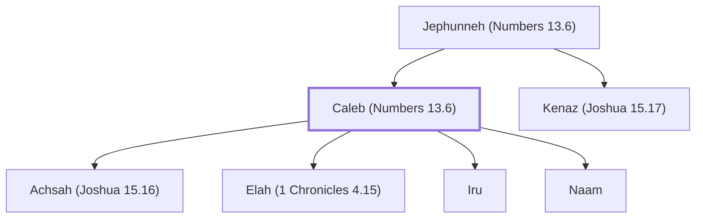

# Caleb (Numbers 13.6)

Faithful spy, given Hebron as inheritance

**Original-language names:** כָּלֵב (H3612)

## When

- **Lived:** [[connections/timeline/16th century BC|1529 BC]] – ? *(Jones)*
- **Placed around:** [[connections/timeline/15th century BC|1444 BC]] *(Ussher: the median date of the passages naming them)*

## Family

- **Father:** [[connections/people/Jephunneh (Numbers 13.6)|Jephunneh (Numbers 13.6)]]
- **Brothers and sisters:** [[connections/people/Kenaz (Joshua 15.17)|Kenaz (Joshua 15.17)]]
- **Children:** [[connections/people/Achsah (Joshua 15.16)|Achsah (Joshua 15.16)]], [[connections/people/Elah (1 Chronicles 4.15)|Elah (1 Chronicles 4.15)]], [[connections/people/Iru|Iru]], [[connections/people/Naam|Naam]]

**Family group:** [[connections/genealogy/Family of Jephunneh (Numbers 13.6)|Family of Jephunneh (Numbers 13.6)]], generation 2

## Events

- [[connections/timeline/16th century BC|1529 BC]] · [[connections/events/Birth of Caleb|Birth of Caleb]]

## Appears in

[[connections/chapters/04-numbers/Numbers 13|Numbers 13 (2)]] · [[connections/chapters/04-numbers/Numbers 14|Numbers 14 (4)]] · [[connections/chapters/04-numbers/Numbers 26|Numbers 26]] · [[connections/chapters/04-numbers/Numbers 32|Numbers 32]] · [[connections/chapters/04-numbers/Numbers 34|Numbers 34]] · [[connections/chapters/05-deuteronomy/Deuteronomy 1|Deuteronomy 1]] · [[connections/chapters/06-joshua/Joshua 14|Joshua 14 (3)]] · [[connections/chapters/06-joshua/Joshua 15|Joshua 15 (5)]] · [[connections/chapters/06-joshua/Joshua 21|Joshua 21]] · [[connections/chapters/07-judges/Judges 1|Judges 1 (5)]] · [[connections/chapters/07-judges/Judges 3|Judges 3]] · [[connections/chapters/09-1-samuel/1 Samuel 30|1 Samuel 30]] · [[connections/chapters/13-1-chronicles/1 Chronicles 4|1 Chronicles 4]] · [[connections/chapters/13-1-chronicles/1 Chronicles 6|1 Chronicles 6]]

## Appears in the same verse as

[[connections/people/Jephunneh (Numbers 13.6)|Jephunneh (Numbers 13.6) (15)]] · [[connections/people/Joshua (Exodus 17.9)|Joshua (Exodus 17.9) (8)]] · [[connections/people/Judah (Genesis 29.35)|Judah (Genesis 29.35) (5)]] · [[connections/people/Nun|Nun (5)]] · [[connections/people/Achsah (Joshua 15.16)|Achsah (Joshua 15.16) (4)]] · [[connections/places/Hebron|Hebron (4)]] · [[connections/people/Anak|Anak (3)]] · [[connections/people/Kenaz (Joshua 15.17)|Kenaz (Joshua 15.17) (3)]] · [[connections/people/Moses|Moses (3)]] · [[connections/people/Othniel|Othniel (3)]] · [[connections/people/Israel|Israel (2)]] · [[connections/places/Debir (Joshua 10.38)|Debir (Joshua 10.38) (2)]] · [[connections/places/Negeb|Negeb (2)]] · [[connections/people/Ahiman (Numbers 13.22)|Ahiman (Numbers 13.22)]] · [[connections/people/Arba|Arba]] · [[connections/people/Elah (1 Chronicles 4.15)|Elah (1 Chronicles 4.15)]] · [[connections/people/Iru|Iru]] · [[connections/people/Kenaz (1 Chronicles 4.15)|Kenaz (1 Chronicles 4.15)]] · [[connections/people/Naam|Naam]] · [[connections/people/Sheshai|Sheshai]] · [[connections/people/Talmai (Numbers 13.22)|Talmai (Numbers 13.22)]] · [[connections/places/Gilgal (Deuteronomy 11.30)|Gilgal (Deuteronomy 11.30)]] · [[connections/places/Kadesh|Kadesh]] · [[connections/places/Ziklag|Ziklag]]
