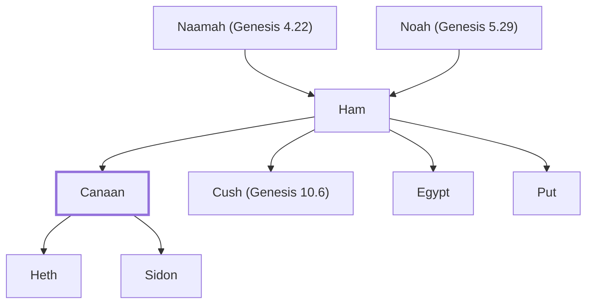

# Canaan

Son of Ham; father of Sidon and Heth

**Original-language names:** כְּנַ֫עַן (H3667a)

## When

- **Placed around:** [[connections/timeline/23rd century BC|2228 BC]] *(Ussher: the median date of the passages naming them)*

## Family

- **Father:** [[connections/people/Ham|Ham]]
- **Brothers and sisters:** [[connections/people/Cush (Genesis 10.6)|Cush (Genesis 10.6)]], [[connections/people/Egypt|Egypt]], [[connections/people/Put|Put]]
- **Children:** [[connections/people/Heth|Heth]], [[connections/people/Sidon|Sidon]]
- **Tribe or nation:** Early Patriarch

**Line of descent** (12 generations, father to son): [[connections/people/Adam|Adam]] → [[connections/people/Seth|Seth]] → [[connections/people/Enosh|Enosh]] → [[connections/people/Kenan|Kenan]] → [[connections/people/Mahalalel (Genesis 5.12)|Mahalalel (Genesis 5.12)]] → [[connections/people/Jared|Jared]] → [[connections/people/Enoch (Genesis 5.18)|Enoch (Genesis 5.18)]] → [[connections/people/Methuselah|Methuselah]] → [[connections/people/Lamech (Genesis 5.25)|Lamech (Genesis 5.25)]] → [[connections/people/Noah (Genesis 5.29)|Noah (Genesis 5.29)]] → [[connections/people/Ham|Ham]] → **Canaan**

**Family group:** [[connections/genealogy/Family of Adam|Family of Adam]], generation 12

## Events

- [[connections/timeline/24th century BC|2346 BC]] · [[connections/events/Noah gets drunk and Canaan is cursed|Noah gets drunk and Canaan is cursed]]
- [[connections/timeline/15th century BC|1451 BC]] · [[connections/events/War with Canaanites|War with Canaanites]]

## Appears in

[[connections/chapters/01-genesis/Genesis 9|Genesis 9 (5)]] · [[connections/chapters/01-genesis/Genesis 10|Genesis 10 (2)]] · [[connections/chapters/13-1-chronicles/1 Chronicles 1|1 Chronicles 1 (2)]]

## Appears in the same verse as

[[connections/people/Ham|Ham (4)]] · [[connections/people/Shem|Shem (3)]] · [[connections/people/Cush (Genesis 10.6)|Cush (Genesis 10.6) (2)]] · [[connections/people/Egypt|Egypt (2)]] · [[connections/people/Heth|Heth (2)]] · [[connections/people/Japheth|Japheth (2)]] · [[connections/people/Put|Put (2)]] · [[connections/people/Sidon|Sidon (2)]] · [[connections/people/Noah (Genesis 5.29)|Noah (Genesis 5.29)]]
