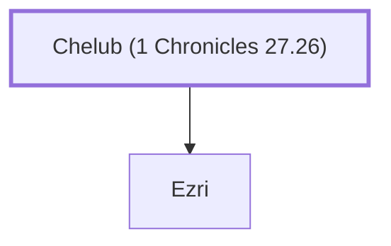

# Chelub (1 Chronicles 27.26)

Overseer of King David's farm workers

**Original-language names:** כְּלוּב (H3620)

## When

- **Placed around:** [[connections/timeline/11th century BC|1015 BC]] *(Ussher: the median date of the passages naming them)*

## Family

- **Children:** [[connections/people/Ezri|Ezri]]

**Family group:** [[connections/genealogy/Family of Chelub (1 Chronicles 27.26)|Family of Chelub (1 Chronicles 27.26)]], generation 1

## Appears in

[[connections/chapters/13-1-chronicles/1 Chronicles 27|1 Chronicles 27]]

## Appears in the same verse as

[[connections/people/Ezri|Ezri]]
