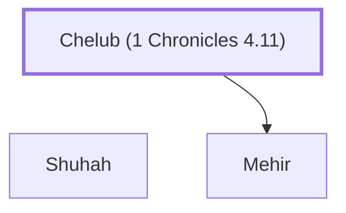

# Chelub (1 Chronicles 4.11)

Caleb's brother, son of Hezron

**Original-language names:** כְּלוּב (H3620)

## When

- **Placed around:** [[connections/timeline/18th century BC|1721 BC]] *(Ussher: the median date of the passages naming them)*

## Family

- **Brothers and sisters:** [[connections/people/Shuhah|Shuhah]]
- **Children:** [[connections/people/Mehir|Mehir]]
- **Tribe or nation:** Tribe of Judah

**Family group:** [[connections/genealogy/Family of Chelub (1 Chronicles 4.11)|Family of Chelub (1 Chronicles 4.11)]], generation 1

## Appears in

[[connections/chapters/13-1-chronicles/1 Chronicles 4|1 Chronicles 4]]

## Appears in the same verse as

[[connections/people/Eshton|Eshton]] · [[connections/people/Mehir|Mehir]] · [[connections/people/Shuhah|Shuhah]]
