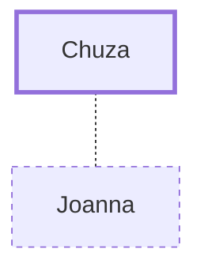

# Chuza

Herod's steward, whose wife Joanna supported Jesus

**Original-language names:** Χουζᾶς (G5529)

## When

- **Placed around:** [[connections/timeline/1st century AD|AD 31]] *(Ussher: the median date of the passages naming them)*

## Family

- **Spouses:** [[connections/people/Joanna|Joanna]]

## Appears in

[[connections/chapters/42-luke/Luke 8|Luke 8]]

## Appears in the same verse as

[[connections/people/Herod (Matthew 14.1)|Herod (Matthew 14.1)]] · [[connections/people/Joanna|Joanna]] · [[connections/people/Susanna|Susanna]]
