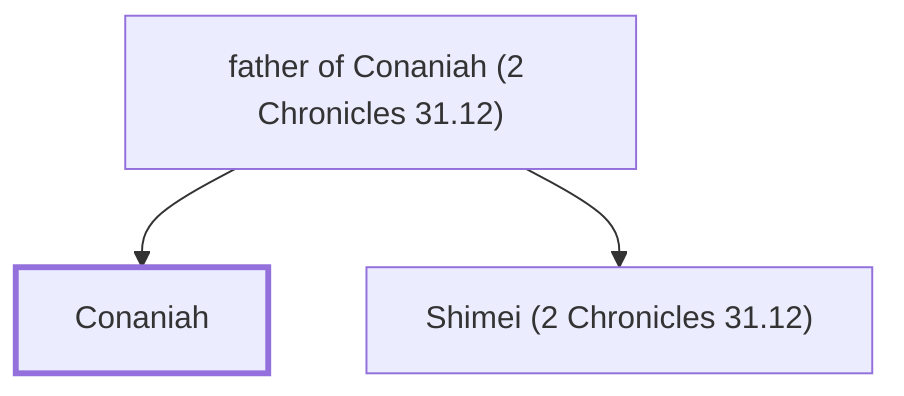

# Conaniah

Levite in charge of offerings during Hezekiah's reign

**Original-language names:** כּוֹנַנְיָ֫הוּ (H3562)

## When

- **Placed around:** [[connections/timeline/8th century BC|726 BC]] *(Ussher: the median date of the passages naming them)*

## Family

- **Father:** [[connections/people/father of Conaniah (2 Chronicles 31.12)|father of Conaniah (2 Chronicles 31.12)]]
- **Brothers and sisters:** [[connections/people/Shimei (2 Chronicles 31.12)|Shimei (2 Chronicles 31.12)]]

**Family group:** [[connections/genealogy/Family of father of Conaniah (2 Chronicles 31.12)|Family of father of Conaniah (2 Chronicles 31.12)]], generation 2

## Appears in

[[connections/chapters/14-2-chronicles/2 Chronicles 31|2 Chronicles 31 (2)]] · [[connections/chapters/14-2-chronicles/2 Chronicles 35|2 Chronicles 35]]

## Appears in the same verse as

[[connections/people/Shimei (2 Chronicles 31.12)|Shimei (2 Chronicles 31.12) (2)]] · [[connections/people/Asahel (2 Chronicles 31.13)|Asahel (2 Chronicles 31.13)]] · [[connections/people/Azariah (2 Chronicles 31.10)|Azariah (2 Chronicles 31.10)]] · [[connections/people/Azaziah (2 Chronicles 31.13)|Azaziah (2 Chronicles 31.13)]] · [[connections/people/Benaiah (2 Chronicles 31.13)|Benaiah (2 Chronicles 31.13)]] · [[connections/people/Eliel (2 Chronicles 31.13)|Eliel (2 Chronicles 31.13)]] · [[connections/people/Hashabiah (2 Chronicles 35.9)|Hashabiah (2 Chronicles 35.9)]] · [[connections/people/Hezekiah (2 Kings 16.20)|Hezekiah (2 Kings 16.20)]] · [[connections/people/Ismachiah|Ismachiah]] · [[connections/people/Jehiel (2 Chronicles 31.13)|Jehiel (2 Chronicles 31.13)]] · [[connections/people/Jeiel (2 Chronicles 35.9)|Jeiel (2 Chronicles 35.9)]] · [[connections/people/Jerimoth (2 Chronicles 31.13)|Jerimoth (2 Chronicles 31.13)]] · [[connections/people/Jozabad (2 Chronicles 31.13)|Jozabad (2 Chronicles 31.13)]] · [[connections/people/Jozabad (2 Chronicles 35.9)|Jozabad (2 Chronicles 35.9)]] · [[connections/people/Mahath (2 Chronicles 31.13)|Mahath (2 Chronicles 31.13)]] · [[connections/people/Nahath (2 Chronicles 31.13)|Nahath (2 Chronicles 31.13)]] · [[connections/people/Nethanel (2 Chronicles 35.9)|Nethanel (2 Chronicles 35.9)]] · [[connections/people/Shemaiah (2 Chronicles 35.9)|Shemaiah (2 Chronicles 35.9)]]
