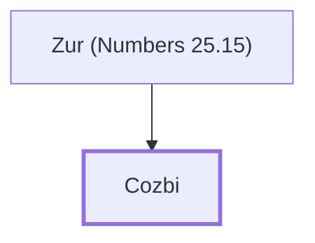

# Cozbi

Midianite woman killed for immorality with an Israelite

**Original-language names:** כָּזְבִי (H3579)

## When

- **Placed around:** [[connections/timeline/15th century BC|1452 BC]] *(Ussher: the median date of the passages naming them)*

## Family

- **Father:** [[connections/people/Zur (Numbers 25.15)|Zur (Numbers 25.15)]]

**Family group:** [[connections/genealogy/Family of Zur (Numbers 25.15)|Family of Zur (Numbers 25.15)]], generation 2

## Appears in

[[connections/chapters/04-numbers/Numbers 25|Numbers 25 (2)]]

## Appears in the same verse as

[[connections/places/Midian|Midian (2)]] · [[connections/people/Zur (Numbers 25.15)|Zur (Numbers 25.15)]] · [[connections/places/Peor|Peor]]
