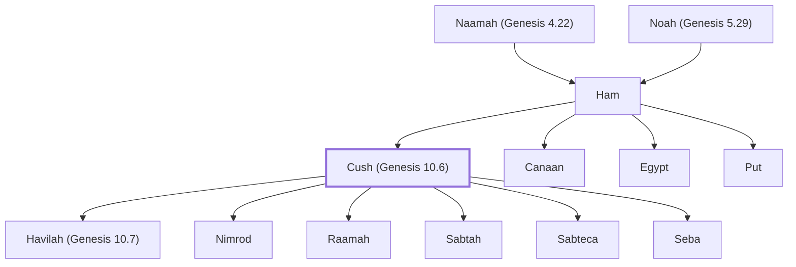

# Cush (Genesis 10.6)

Son of Ham; father of Nimrod and other descendants

**Original-language names:** כּוּשׁ (H3568a)

## When

- **Placed around:** [[connections/timeline/23rd century BC|2228 BC]] *(Ussher: the median date of the passages naming them)*

## Family

- **Father:** [[connections/people/Ham|Ham]]
- **Brothers and sisters:** [[connections/people/Canaan|Canaan]], [[connections/people/Egypt|Egypt]], [[connections/people/Put|Put]]
- **Children:** [[connections/people/Havilah (Genesis 10.7)|Havilah (Genesis 10.7)]], [[connections/people/Nimrod|Nimrod]], [[connections/people/Raamah|Raamah]], [[connections/people/Sabtah|Sabtah]], [[connections/people/Sabteca|Sabteca]], [[connections/people/Seba|Seba]]
- **Tribe or nation:** Early Patriarch

**Line of descent** (12 generations, father to son): [[connections/people/Adam|Adam]] → [[connections/people/Seth|Seth]] → [[connections/people/Enosh|Enosh]] → [[connections/people/Kenan|Kenan]] → [[connections/people/Mahalalel (Genesis 5.12)|Mahalalel (Genesis 5.12)]] → [[connections/people/Jared|Jared]] → [[connections/people/Enoch (Genesis 5.18)|Enoch (Genesis 5.18)]] → [[connections/people/Methuselah|Methuselah]] → [[connections/people/Lamech (Genesis 5.25)|Lamech (Genesis 5.25)]] → [[connections/people/Noah (Genesis 5.29)|Noah (Genesis 5.29)]] → [[connections/people/Ham|Ham]] → **Cush (Genesis 10.6)**

**Family group:** [[connections/genealogy/Family of Adam|Family of Adam]], generation 12

## Appears in

[[connections/chapters/01-genesis/Genesis 10|Genesis 10 (3)]] · [[connections/chapters/13-1-chronicles/1 Chronicles 1|1 Chronicles 1 (3)]]

## Appears in the same verse as

[[connections/people/Canaan|Canaan (2)]] · [[connections/people/Dedan (Genesis 10.7)|Dedan (Genesis 10.7) (2)]] · [[connections/people/Egypt|Egypt (2)]] · [[connections/people/Ham|Ham (2)]] · [[connections/people/Havilah (Genesis 10.7)|Havilah (Genesis 10.7) (2)]] · [[connections/people/Nimrod|Nimrod (2)]] · [[connections/people/Put|Put (2)]] · [[connections/people/Raamah|Raamah (2)]] · [[connections/people/Sabtah|Sabtah (2)]] · [[connections/people/Sabteca|Sabteca (2)]] · [[connections/people/Seba|Seba (2)]] · [[connections/people/Sheba (Genesis 10.7)|Sheba (Genesis 10.7) (2)]]
