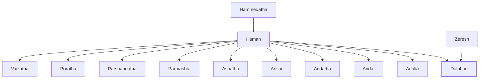

# Dalphon

Son of Haman, enemy of the Jews

**Original-language names:** דַּלְפוֹן (H1813)

## When

- **Placed around:** [[connections/timeline/5th century BC|452 BC]] *(Ussher: the median date of the passages naming them)*

## Family

- **Father:** [[connections/people/Haman|Haman]]
- **Mother:** [[connections/people/Zeresh|Zeresh (uncertain)]]
- **Brothers and sisters:** [[connections/people/Adalia|Adalia]], [[connections/people/Aridai|Aridai]], [[connections/people/Aridatha|Aridatha]], [[connections/people/Arisai|Arisai]], [[connections/people/Aspatha|Aspatha]], [[connections/people/Parmashta|Parmashta]], [[connections/people/Parshandatha|Parshandatha]], [[connections/people/Poratha|Poratha]], [[connections/people/Vaizatha|Vaizatha]]

**Line of descent** (3 generations, father to son): [[connections/people/Hammedatha|Hammedatha]] → [[connections/people/Haman|Haman]] → **Dalphon**

**Family group:** [[connections/genealogy/Family of Hammedatha|Family of Hammedatha]], generation 3

## Appears in

[[connections/chapters/17-esther/Esther 9|Esther 9]]

## Appears in the same verse as

[[connections/people/Aspatha|Aspatha]] · [[connections/people/Parshandatha|Parshandatha]]
