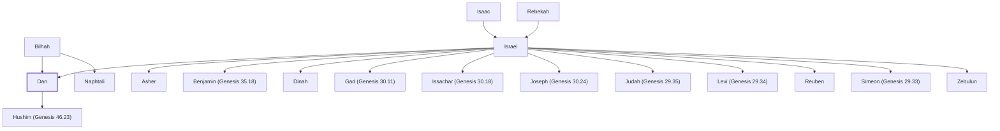

# Dan

Fifth son of Jacob, founder of Israelite tribe

**Original-language names:** דָּן (H1835)

## When

- **Lived:** [[connections/timeline/18th century BC|1755 BC]] – ? *(Jones)*
- **Placed around:** [[connections/timeline/18th century BC|1706 BC]] *(Ussher: the median date of the passages naming them)*

## Family

- **Father:** [[connections/people/Israel|Israel]]
- **Mother:** [[connections/people/Bilhah|Bilhah]]
- **Brothers and sisters:** [[connections/people/Asher|Asher]], [[connections/people/Benjamin (Genesis 35.18)|Benjamin (Genesis 35.18)]], [[connections/people/Dinah|Dinah]], [[connections/people/Gad (Genesis 30.11)|Gad (Genesis 30.11)]], [[connections/people/Issachar (Genesis 30.18)|Issachar (Genesis 30.18)]], [[connections/people/Joseph (Genesis 30.24)|Joseph (Genesis 30.24)]], [[connections/people/Judah (Genesis 29.35)|Judah (Genesis 29.35)]], [[connections/people/Levi (Genesis 29.34)|Levi (Genesis 29.34)]], [[connections/people/Naphtali|Naphtali]], [[connections/people/Reuben|Reuben]], [[connections/people/Simeon (Genesis 29.33)|Simeon (Genesis 29.33)]], [[connections/people/Zebulun|Zebulun]]
- **Children:** [[connections/people/Hushim (Genesis 46.23)|Hushim (Genesis 46.23)]]
- **Tribe or nation:** Tribe of Dan

**Line of descent** (24 generations, father to son): [[connections/people/Adam|Adam]] → [[connections/people/Seth|Seth]] → [[connections/people/Enosh|Enosh]] → [[connections/people/Kenan|Kenan]] → [[connections/people/Mahalalel (Genesis 5.12)|Mahalalel (Genesis 5.12)]] → [[connections/people/Jared|Jared]] → [[connections/people/Enoch (Genesis 5.18)|Enoch (Genesis 5.18)]] → [[connections/people/Methuselah|Methuselah]] → [[connections/people/Lamech (Genesis 5.25)|Lamech (Genesis 5.25)]] → [[connections/people/Noah (Genesis 5.29)|Noah (Genesis 5.29)]] → [[connections/people/Shem|Shem]] → [[connections/people/Arpachshad|Arpachshad]] → [[connections/people/Cainan|Cainan]] → [[connections/people/Shelah (Genesis 10.24)|Shelah (Genesis 10.24)]] → [[connections/people/Eber (Genesis 10.21)|Eber (Genesis 10.21)]] → [[connections/people/Peleg|Peleg]] → [[connections/people/Reu|Reu]] → [[connections/people/Serug|Serug]] → [[connections/people/Nahor (Genesis 11.22)|Nahor (Genesis 11.22)]] → [[connections/people/Terah|Terah]] → [[connections/people/Abraham|Abraham]] → [[connections/people/Isaac|Isaac]] → [[connections/people/Israel|Israel]] → **Dan**

**Family group:** [[connections/genealogy/Family of Adam|Family of Adam]], generation 24

## Events

- [[connections/timeline/18th century BC|1755 BC]] · [[connections/events/Birth of Dan|Birth of Dan]]
- [[connections/timeline/18th century BC|1728 BC]] · [[connections/events/Joseph sold to Egypt|Joseph sold to Egypt]]
- [[connections/timeline/18th century BC|1708 BC]] · [[connections/events/7 years of famine|7 years of famine]]
- [[connections/timeline/18th century BC|1706 BC]] · [[connections/events/Joseph's brothers return to Egypt|Joseph's brothers return to Egypt]]

## Appears in

[[connections/chapters/01-genesis/Genesis 30|Genesis 30]] · [[connections/chapters/01-genesis/Genesis 35|Genesis 35]] · [[connections/chapters/01-genesis/Genesis 46|Genesis 46]] · [[connections/chapters/01-genesis/Genesis 49|Genesis 49 (2)]] · [[connections/chapters/13-1-chronicles/1 Chronicles 2|1 Chronicles 2]]

## Appears in the same verse as

[[connections/people/Naphtali|Naphtali (2)]] · [[connections/people/Rachel|Rachel (2)]] · [[connections/people/Asher|Asher]] · [[connections/people/Benjamin (Genesis 35.18)|Benjamin (Genesis 35.18)]] · [[connections/people/Bilhah|Bilhah]] · [[connections/people/Gad (Genesis 30.11)|Gad (Genesis 30.11)]] · [[connections/people/Hushim (Genesis 46.23)|Hushim (Genesis 46.23)]] · [[connections/people/Israel|Israel]] · [[connections/people/Joseph (Genesis 30.24)|Joseph (Genesis 30.24)]]
