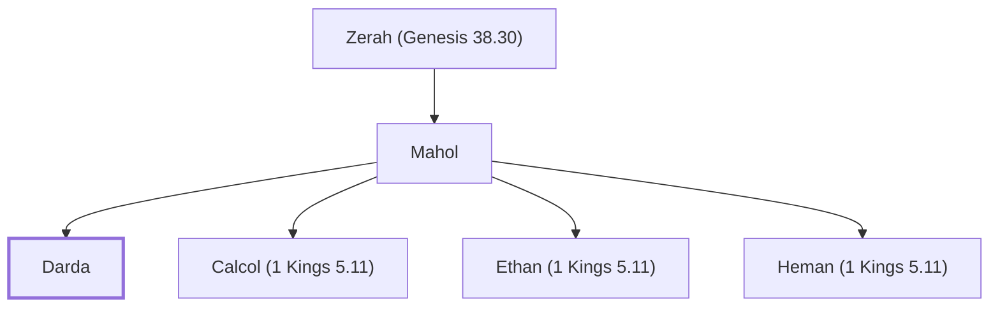

# Darda

Wise man surpassed by Solomon's wisdom

**Original-language names:** דַּרְדַּע (H1862)

## When

- **Placed around:** [[connections/timeline/11th century BC|1014 BC]] *(Ussher: the median date of the passages naming them)*

## Family

- **Father:** [[connections/people/Mahol|Mahol]]
- **Brothers and sisters:** [[connections/people/Calcol (1 Kings 5.11)|Calcol (1 Kings 5.11)]], [[connections/people/Ethan (1 Kings 5.11)|Ethan (1 Kings 5.11)]], [[connections/people/Heman (1 Kings 5.11)|Heman (1 Kings 5.11)]]
- **Tribe or nation:** Tribe of Judah

**Family group:** [[connections/genealogy/Family of Adam|Family of Adam]], generation 29

## Appears in

[[connections/chapters/11-1-kings/1 Kings 5|1 Kings 5]]

## Appears in the same verse as

[[connections/people/Calcol (1 Kings 5.11)|Calcol (1 Kings 5.11)]] · [[connections/people/Ethan (1 Kings 5.11)|Ethan (1 Kings 5.11)]] · [[connections/people/Heman (1 Kings 5.11)|Heman (1 Kings 5.11)]] · [[connections/people/Mahol|Mahol]]
