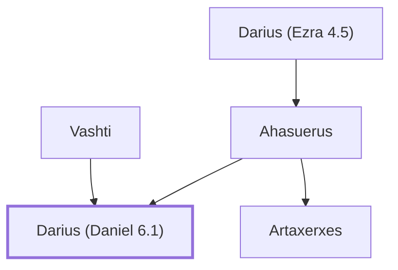

# Darius (Daniel 6.1)

Mede who became Emperor over Babylon

**Original-language names:** דָּֽרְיָ֫וֶשׁ (H1867) · דָּֽרְיָ֫וֶשׁ (H1868)

## When

- **Placed around:** [[connections/timeline/6th century BC|538 BC]] *(Ussher: the median date of the passages naming them)*

## Family

- **Father:** [[connections/people/Ahasuerus|Ahasuerus]]
- **Mother:** [[connections/people/Vashti|Vashti]]
- **Brothers and sisters:** [[connections/people/Artaxerxes|Artaxerxes]]
- **Tribe or nation:** Persia

**Line of descent** (3 generations, father to son): [[connections/people/Darius (Ezra 4.5)|Darius (Ezra 4.5)]] → [[connections/people/Ahasuerus|Ahasuerus]] → **Darius (Daniel 6.1)**

**Family group:** [[connections/genealogy/Family of Darius (Ezra 4.5)|Family of Darius (Ezra 4.5)]], generation 3

## Appears in

[[connections/chapters/27-daniel/Daniel 6|Daniel 6 (6)]] · [[connections/chapters/27-daniel/Daniel 9|Daniel 9]] · [[connections/chapters/27-daniel/Daniel 11|Daniel 11]]

## Appears in the same verse as

[[connections/places/Media|Media (2)]] · [[connections/people/Ahasuerus|Ahasuerus]] · [[connections/people/Cyrus|Cyrus]] · [[connections/people/Daniel (Ezekiel 14.14)|Daniel (Ezekiel 14.14)]] · [[connections/places/Chaldea|Chaldea]] · [[connections/places/Persia|Persia]]
