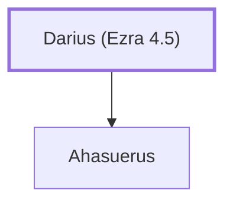

# Darius (Ezra 4.5)

Persian king who decreed the rebuilding of the Temple

**Original-language names:** דָּֽרְיָ֫וֶשׁ (H1867) · דָּֽרְיָ֫וֶשׁ (H1868)

## When

- **Placed around:** [[connections/timeline/6th century BC|519 BC]] *(Ussher: the median date of the passages naming them)*
- **Reigned / in office:** [[connections/timeline/6th century BC|522 BC]] – [[connections/timeline/5th century BC|486 BC]] *(modern dates)* · Darius I, Persia · [Wikidata Q44387](https://www.wikidata.org/wiki/Q44387)

## Family

- **Children:** [[connections/people/Ahasuerus|Ahasuerus]]
- **Tribe or nation:** Persia

**Family group:** [[connections/genealogy/Family of Darius (Ezra 4.5)|Family of Darius (Ezra 4.5)]], generation 1

## Appears in

[[connections/chapters/15-ezra/Ezra 4|Ezra 4 (2)]] · [[connections/chapters/15-ezra/Ezra 5|Ezra 5 (3)]] · [[connections/chapters/15-ezra/Ezra 6|Ezra 6 (5)]] · [[connections/chapters/37-haggai/Haggai 1|Haggai 1 (2)]] · [[connections/chapters/37-haggai/Haggai 2|Haggai 2]] · [[connections/chapters/38-zechariah/Zechariah 1|Zechariah 1 (2)]] · [[connections/chapters/38-zechariah/Zechariah 7|Zechariah 7]]

## Appears in the same verse as

[[connections/people/Zechariah (Ezra 5.1)|Zechariah (Ezra 5.1) (4)]] · [[connections/people/Haggai|Haggai (3)]] · [[connections/people/Iddo (Ezra 5.1)|Iddo (Ezra 5.1) (3)]] · [[connections/people/Judah (Genesis 29.35)|Judah (Genesis 29.35) (3)]] · [[connections/places/Persia|Persia (3)]] · [[connections/people/Berechiah (Zechariah 1.1)|Berechiah (Zechariah 1.1) (2)]] · [[connections/people/Cyrus|Cyrus (2)]] · [[connections/people/Shethar-bozenai|Shethar-bozenai (2)]] · [[connections/people/Tattenai|Tattenai (2)]] · [[connections/places/Euphrates|Euphrates (2)]] · [[connections/places/Jerusalem|Jerusalem (2)]] · [[connections/people/Artaxerxes|Artaxerxes]] · [[connections/people/Israel|Israel]] · [[connections/people/Jehozadak|Jehozadak]] · [[connections/people/Joshua (Ezra 2.2)|Joshua (Ezra 2.2)]] · [[connections/people/Shealtiel (1 Chronicles 3.17)|Shealtiel (1 Chronicles 3.17)]] · [[connections/people/Zerubbabel (1 Chronicles 3.19)|Zerubbabel (1 Chronicles 3.19)]] · [[connections/places/Babylon|Babylon]]
