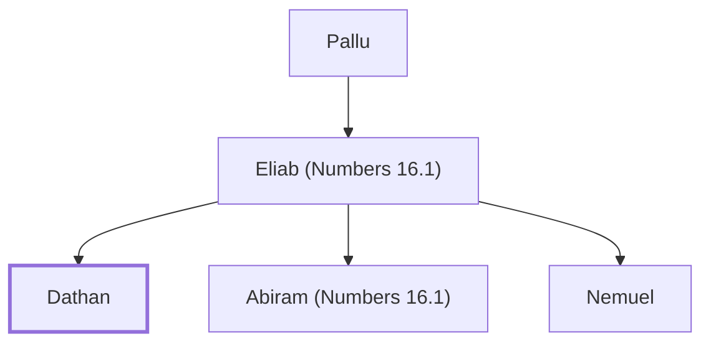

# Dathan

Reubenite who rebelled against Moses and Aaron

**Original-language names:** דָּתָן (H1885)

## When

- **Placed around:** [[connections/timeline/15th century BC|1471 BC]] *(Ussher: the median date of the passages naming them)*

## Family

- **Father:** [[connections/people/Eliab (Numbers 16.1)|Eliab (Numbers 16.1)]]
- **Brothers and sisters:** [[connections/people/Abiram (Numbers 16.1)|Abiram (Numbers 16.1)]], [[connections/people/Nemuel|Nemuel]]
- **Tribe or nation:** Tribe of Reuben

**Line of descent** (27 generations, father to son): [[connections/people/Adam|Adam]] → [[connections/people/Seth|Seth]] → [[connections/people/Enosh|Enosh]] → [[connections/people/Kenan|Kenan]] → [[connections/people/Mahalalel (Genesis 5.12)|Mahalalel (Genesis 5.12)]] → [[connections/people/Jared|Jared]] → [[connections/people/Enoch (Genesis 5.18)|Enoch (Genesis 5.18)]] → [[connections/people/Methuselah|Methuselah]] → [[connections/people/Lamech (Genesis 5.25)|Lamech (Genesis 5.25)]] → [[connections/people/Noah (Genesis 5.29)|Noah (Genesis 5.29)]] → [[connections/people/Shem|Shem]] → [[connections/people/Arpachshad|Arpachshad]] → [[connections/people/Cainan|Cainan]] → [[connections/people/Shelah (Genesis 10.24)|Shelah (Genesis 10.24)]] → [[connections/people/Eber (Genesis 10.21)|Eber (Genesis 10.21)]] → [[connections/people/Peleg|Peleg]] → [[connections/people/Reu|Reu]] → [[connections/people/Serug|Serug]] → [[connections/people/Nahor (Genesis 11.22)|Nahor (Genesis 11.22)]] → [[connections/people/Terah|Terah]] → [[connections/people/Abraham|Abraham]] → [[connections/people/Isaac|Isaac]] → [[connections/people/Israel|Israel]] → [[connections/people/Reuben|Reuben]] → [[connections/people/Pallu|Pallu]] → [[connections/people/Eliab (Numbers 16.1)|Eliab (Numbers 16.1)]] → **Dathan**

**Family group:** [[connections/genealogy/Family of Adam|Family of Adam]], generation 27

## Appears in

[[connections/chapters/04-numbers/Numbers 16|Numbers 16 (5)]] · [[connections/chapters/04-numbers/Numbers 26|Numbers 26]] · [[connections/chapters/05-deuteronomy/Deuteronomy 11|Deuteronomy 11]] · [[connections/chapters/19-psalms/Psalms 106|Psalms 106]]

## Appears in the same verse as

[[connections/people/Abiram (Numbers 16.1)|Abiram (Numbers 16.1) (8)]] · [[connections/people/Eliab (Numbers 16.1)|Eliab (Numbers 16.1) (4)]] · [[connections/people/Korah (Exodus 6.21)|Korah (Exodus 6.21) (4)]] · [[connections/people/Moses|Moses (3)]] · [[connections/people/Israel|Israel (2)]] · [[connections/people/Reuben|Reuben (2)]] · [[connections/people/Aaron|Aaron]] · [[connections/people/Izhar (Exodus 6.18)|Izhar (Exodus 6.18)]] · [[connections/people/Kohath|Kohath]] · [[connections/people/Levi (Genesis 29.34)|Levi (Genesis 29.34)]] · [[connections/people/Nemuel|Nemuel]] · [[connections/people/On|On]] · [[connections/people/Peleth (Numbers 16.1)|Peleth (Numbers 16.1)]]
