# David

Anointed king of Israel, ancestor of Jesus Christ

**Original-language names:** דָּוִד (H1732) · Δαυείδ, Δαυίδ, Δαβίδ (G1138)

## When

- **Lived:** [[connections/timeline/11th century BC|1085 BC]] – [[connections/timeline/11th century BC|1015 BC]] *(Jones)*
- **Placed around:** [[connections/timeline/11th century BC|1036 BC]] *(Ussher: the median date of the passages naming them)*

## Family

- **Father:** [[connections/people/Jesse|Jesse]]
- **Mother:** [[connections/people/Nahash (2 Samuel 17.25)|Nahash (2 Samuel 17.25)]]
- **Brothers and sisters:** [[connections/people/Abigail (2 Samuel 17.25)|Abigail (2 Samuel 17.25) (uncertain)]], [[connections/people/Abinadab (1 Samuel 16.8)|Abinadab (1 Samuel 16.8)]], [[connections/people/Eliab (1 Samuel 16.6)|Eliab (1 Samuel 16.6)]], [[connections/people/Elihu (1 Chronicles 27.18)|Elihu (1 Chronicles 27.18)]], [[connections/people/Nethanel (1 Chronicles 2.14)|Nethanel (1 Chronicles 2.14)]], [[connections/people/Ozem (1 Chronicles 2.15)|Ozem (1 Chronicles 2.15)]], [[connections/people/Raddai|Raddai]], [[connections/people/Shimeah (1 Samuel 16.9)|Shimeah (1 Samuel 16.9)]], [[connections/people/Zeruiah|Zeruiah]]
- **Spouses:** [[connections/people/Abigail (1 Samuel 25.3)|Abigail (1 Samuel 25.3)]], [[connections/people/Abital|Abital]], [[connections/people/Ahinoam (1 Samuel 25.43)|Ahinoam (1 Samuel 25.43)]], [[connections/people/Bathsheba|Bathsheba]], [[connections/people/Eglah|Eglah]], [[connections/people/Haggith|Haggith]], [[connections/people/Jerusalem wives (2 Samuel 5.13)|Jerusalem wives (2 Samuel 5.13)]], [[connections/people/Maacah (2 Samuel 3.3)|Maacah (2 Samuel 3.3)]], [[connections/people/Michal|Michal]]
- **Children:** [[connections/people/Absalom|Absalom]], [[connections/people/Adonijah (2 Samuel 3.4)|Adonijah (2 Samuel 3.4)]], [[connections/people/Amnon (2 Samuel 3.2)|Amnon (2 Samuel 3.2)]], [[connections/people/Chileab|Chileab]], [[connections/people/Eliada (2 Samuel 5.16)|Eliada (2 Samuel 5.16)]], [[connections/people/Eliphelet (2 Samuel 5.16)|Eliphelet (2 Samuel 5.16)]], [[connections/people/Elishama (2 Samuel 5.16)|Elishama (2 Samuel 5.16)]], [[connections/people/Elishua|Elishua]], [[connections/people/Elpelet|Elpelet]], [[connections/people/Ibhar|Ibhar]], [[connections/people/Ithream|Ithream]], [[connections/people/Japhia (2 Samuel 5.15)|Japhia (2 Samuel 5.15)]], [[connections/people/Jerimoth (2 Chronicles 11.18)|Jerimoth (2 Chronicles 11.18)]], [[connections/people/Nathan (2 Samuel 5.14)|Nathan (2 Samuel 5.14)]], [[connections/people/Nepheg (2 Samuel 5.15)|Nepheg (2 Samuel 5.15)]], [[connections/people/Nogah|Nogah]], [[connections/people/Shammua (2 Samuel 5.14)|Shammua (2 Samuel 5.14)]], [[connections/people/Shephatiah (2 Samuel 3.4)|Shephatiah (2 Samuel 3.4)]], [[connections/people/Shobab (2 Samuel 5.14)|Shobab (2 Samuel 5.14)]], [[connections/people/Solomon|Solomon]], [[connections/people/Tamar (2 Samuel 13.1)|Tamar (2 Samuel 13.1)]]
- **Tribe or nation:** Tribe of Judah

**Line of descent** (34 generations, father to son): [[connections/people/Adam|Adam]] → [[connections/people/Seth|Seth]] → [[connections/people/Enosh|Enosh]] → [[connections/people/Kenan|Kenan]] → [[connections/people/Mahalalel (Genesis 5.12)|Mahalalel (Genesis 5.12)]] → [[connections/people/Jared|Jared]] → [[connections/people/Enoch (Genesis 5.18)|Enoch (Genesis 5.18)]] → [[connections/people/Methuselah|Methuselah]] → [[connections/people/Lamech (Genesis 5.25)|Lamech (Genesis 5.25)]] → [[connections/people/Noah (Genesis 5.29)|Noah (Genesis 5.29)]] → [[connections/people/Shem|Shem]] → [[connections/people/Arpachshad|Arpachshad]] → [[connections/people/Cainan|Cainan]] → [[connections/people/Shelah (Genesis 10.24)|Shelah (Genesis 10.24)]] → [[connections/people/Eber (Genesis 10.21)|Eber (Genesis 10.21)]] → [[connections/people/Peleg|Peleg]] → [[connections/people/Reu|Reu]] → [[connections/people/Serug|Serug]] → [[connections/people/Nahor (Genesis 11.22)|Nahor (Genesis 11.22)]] → [[connections/people/Terah|Terah]] → [[connections/people/Abraham|Abraham]] → [[connections/people/Isaac|Isaac]] → [[connections/people/Israel|Israel]] → [[connections/people/Judah (Genesis 29.35)|Judah (Genesis 29.35)]] → [[connections/people/Perez|Perez]] → [[connections/people/Hezron (Genesis 46.12)|Hezron (Genesis 46.12)]] → [[connections/people/Ram (Ruth 4.19)|Ram (Ruth 4.19)]] → [[connections/people/Amminadab (Exodus 6.23)|Amminadab (Exodus 6.23)]] → [[connections/people/Nahshon|Nahshon]] → [[connections/people/Salmon|Salmon]] → [[connections/people/Boaz|Boaz]] → [[connections/people/Obed (Ruth 4.17)|Obed (Ruth 4.17)]] → [[connections/people/Jesse|Jesse]] → **David**

**Family group:** [[connections/genealogy/Family of Adam|Family of Adam]], generation 34

```mermaid
flowchart TB
  n0["David"]:::me
  n1["Obed (Ruth 4.17)"]
  n2["Jesse"]
  n1 --> n2
  n2 --> n0
  n3["Nahash (2 Samuel 17.25)"]
  n3 --> n0
  n4["Abigail (2 Samuel 17.25)"]
  n2 --> n4
  n5["Abinadab (1 Samuel 16.8)"]
  n2 --> n5
  n6["Eliab (1 Samuel 16.6)"]
  n2 --> n6
  n7["Elihu (1 Chronicles 27.18)"]
  n2 --> n7
  n8["Nethanel (1 Chronicles 2.14)"]
  n2 --> n8
  n9["Ozem (1 Chronicles 2.15)"]
  n2 --> n9
  n10["Raddai"]
  n2 --> n10
  n11["Shimeah (1 Samuel 16.9)"]
  n2 --> n11
  n12["Zeruiah"]
  n2 --> n12
  n13["Abigail (1 Samuel 25.3)"]:::spouse
  n0 -.- n13
  n14["Abital"]:::spouse
  n0 -.- n14
  n15["Ahinoam (1 Samuel 25.43)"]:::spouse
  n0 -.- n15
  n16["Bathsheba"]:::spouse
  n0 -.- n16
  n17["Eglah"]:::spouse
  n0 -.- n17
  n18["Haggith"]:::spouse
  n0 -.- n18
  n19["Jerusalem wives (2 Samuel 5.13)"]:::spouse
  n0 -.- n19
  n20["Maacah (2 Samuel 3.3)"]:::spouse
  n0 -.- n20
  n21["Michal"]:::spouse
  n0 -.- n21
  n22["Absalom"]
  n0 --> n22
  n23["Adonijah (2 Samuel 3.4)"]
  n0 --> n23
  n24["Amnon (2 Samuel 3.2)"]
  n0 --> n24
  n25["Chileab"]
  n0 --> n25
  n26["Eliada (2 Samuel 5.16)"]
  n0 --> n26
  n27["Eliphelet (2 Samuel 5.16)"]
  n0 --> n27
  n28["Elishama (2 Samuel 5.16)"]
  n0 --> n28
  n29["Elishua"]
  n0 --> n29
  n30["Elpelet"]
  n0 --> n30
  n31["Ibhar"]
  n0 --> n31
  n32["Ithream"]
  n0 --> n32
  n33["Japhia (2 Samuel 5.15)"]
  n0 --> n33
  n34["Jerimoth (2 Chronicles 11.18)"]
  n0 --> n34
  n35["Nathan (2 Samuel 5.14)"]
  n0 --> n35
  n36["Nepheg (2 Samuel 5.15)"]
  n0 --> n36
  n37["Nogah"]
  n0 --> n37
  n38["Shammua (2 Samuel 5.14)"]
  n0 --> n38
  n39["Shephatiah (2 Samuel 3.4)"]
  n0 --> n39
  n40["Shobab (2 Samuel 5.14)"]
  n0 --> n40
  n41["Solomon"]
  n0 --> n41
  n42["Tamar (2 Samuel 13.1)"]
  n0 --> n42
  classDef me stroke-width:3px
  classDef spouse stroke-dasharray:4
```

## Events

- [[connections/timeline/11th century BC|1067 BC]] · [[connections/events/David Kills Goliath|David Kills Goliath]]
- [[connections/timeline/11th century BC|1055 BC]] · [[connections/events/Reign of David|Reign of David]]
- [[connections/timeline/11th century BC|1015 BC]] · [[connections/events/Death of David|Death of David]]

## Appears in

[[connections/chapters/08-ruth/Ruth 4|Ruth 4 (2)]] · [[connections/chapters/09-1-samuel/1 Samuel 16|1 Samuel 16 (6)]] · [[connections/chapters/09-1-samuel/1 Samuel 17|1 Samuel 17 (30)]] · [[connections/chapters/09-1-samuel/1 Samuel 18|1 Samuel 18 (27)]] · [[connections/chapters/09-1-samuel/1 Samuel 19|1 Samuel 19 (16)]] · [[connections/chapters/09-1-samuel/1 Samuel 20|1 Samuel 20 (20)]] · [[connections/chapters/09-1-samuel/1 Samuel 21|1 Samuel 21 (10)]] · [[connections/chapters/09-1-samuel/1 Samuel 22|1 Samuel 22 (10)]] · [[connections/chapters/09-1-samuel/1 Samuel 23|1 Samuel 23 (21)]] · [[connections/chapters/09-1-samuel/1 Samuel 24|1 Samuel 24 (12)]] · [[connections/chapters/09-1-samuel/1 Samuel 25|1 Samuel 25 (20)]] · [[connections/chapters/09-1-samuel/1 Samuel 26|1 Samuel 26 (18)]] · [[connections/chapters/09-1-samuel/1 Samuel 27|1 Samuel 27 (11)]] · [[connections/chapters/09-1-samuel/1 Samuel 28|1 Samuel 28 (3)]] · [[connections/chapters/09-1-samuel/1 Samuel 29|1 Samuel 29 (7)]] · [[connections/chapters/09-1-samuel/1 Samuel 30|1 Samuel 30 (21)]] · [[connections/chapters/10-2-samuel/2 Samuel 1|2 Samuel 1 (11)]] · [[connections/chapters/10-2-samuel/2 Samuel 2|2 Samuel 2 (12)]] · [[connections/chapters/10-2-samuel/2 Samuel 3|2 Samuel 3 (19)]] · [[connections/chapters/10-2-samuel/2 Samuel 4|2 Samuel 4 (3)]] · [[connections/chapters/10-2-samuel/2 Samuel 5|2 Samuel 5 (17)]] · [[connections/chapters/10-2-samuel/2 Samuel 6|2 Samuel 6 (14)]] · [[connections/chapters/10-2-samuel/2 Samuel 7|2 Samuel 7 (6)]] · [[connections/chapters/10-2-samuel/2 Samuel 8|2 Samuel 8 (15)]] · [[connections/chapters/10-2-samuel/2 Samuel 9|2 Samuel 9 (5)]] · [[connections/chapters/10-2-samuel/2 Samuel 10|2 Samuel 10 (8)]] · [[connections/chapters/10-2-samuel/2 Samuel 11|2 Samuel 11 (19)]] · [[connections/chapters/10-2-samuel/2 Samuel 12|2 Samuel 12 (14)]] · [[connections/chapters/10-2-samuel/2 Samuel 13|2 Samuel 13 (7)]] · [[connections/chapters/10-2-samuel/2 Samuel 15|2 Samuel 15 (9)]] · [[connections/chapters/10-2-samuel/2 Samuel 16|2 Samuel 16 (8)]] · [[connections/chapters/10-2-samuel/2 Samuel 17|2 Samuel 17 (8)]] · [[connections/chapters/10-2-samuel/2 Samuel 18|2 Samuel 18 (5)]] · [[connections/chapters/10-2-samuel/2 Samuel 19|2 Samuel 19 (5)]] · [[connections/chapters/10-2-samuel/2 Samuel 20|2 Samuel 20 (7)]] · [[connections/chapters/10-2-samuel/2 Samuel 21|2 Samuel 21 (10)]] · [[connections/chapters/10-2-samuel/2 Samuel 22|2 Samuel 22 (2)]] · [[connections/chapters/10-2-samuel/2 Samuel 23|2 Samuel 23 (8)]] · [[connections/chapters/10-2-samuel/2 Samuel 24|2 Samuel 24 (13)]] · [[connections/chapters/11-1-kings/1 Kings 1|1 Kings 1 (11)]] · [[connections/chapters/11-1-kings/1 Kings 2|1 Kings 2 (10)]] · [[connections/chapters/11-1-kings/1 Kings 3|1 Kings 3 (5)]] · [[connections/chapters/11-1-kings/1 Kings 5|1 Kings 5 (4)]] · [[connections/chapters/11-1-kings/1 Kings 6|1 Kings 6]] · [[connections/chapters/11-1-kings/1 Kings 7|1 Kings 7]] · [[connections/chapters/11-1-kings/1 Kings 8|1 Kings 8 (10)]] · [[connections/chapters/11-1-kings/1 Kings 9|1 Kings 9 (3)]] · [[connections/chapters/11-1-kings/1 Kings 11|1 Kings 11 (15)]] · [[connections/chapters/11-1-kings/1 Kings 12|1 Kings 12 (4)]] · [[connections/chapters/11-1-kings/1 Kings 13|1 Kings 13]] · [[connections/chapters/11-1-kings/1 Kings 14|1 Kings 14 (2)]] · [[connections/chapters/11-1-kings/1 Kings 15|1 Kings 15 (6)]] · [[connections/chapters/11-1-kings/1 Kings 22|1 Kings 22]] · [[connections/chapters/12-2-kings/2 Kings 8|2 Kings 8 (2)]] · [[connections/chapters/12-2-kings/2 Kings 9|2 Kings 9]] · [[connections/chapters/12-2-kings/2 Kings 11|2 Kings 11]] · [[connections/chapters/12-2-kings/2 Kings 12|2 Kings 12]] · [[connections/chapters/12-2-kings/2 Kings 14|2 Kings 14 (2)]] · [[connections/chapters/12-2-kings/2 Kings 15|2 Kings 15 (2)]] · [[connections/chapters/12-2-kings/2 Kings 16|2 Kings 16 (2)]] · [[connections/chapters/12-2-kings/2 Kings 17|2 Kings 17]] · [[connections/chapters/12-2-kings/2 Kings 18|2 Kings 18]] · [[connections/chapters/12-2-kings/2 Kings 19|2 Kings 19]] · [[connections/chapters/12-2-kings/2 Kings 20|2 Kings 20 (2)]] · [[connections/chapters/12-2-kings/2 Kings 21|2 Kings 21]] · [[connections/chapters/12-2-kings/2 Kings 22|2 Kings 22]] · [[connections/chapters/13-1-chronicles/1 Chronicles 2|1 Chronicles 2]] · [[connections/chapters/13-1-chronicles/1 Chronicles 3|1 Chronicles 3 (2)]] · [[connections/chapters/13-1-chronicles/1 Chronicles 4|1 Chronicles 4]] · [[connections/chapters/13-1-chronicles/1 Chronicles 6|1 Chronicles 6]] · [[connections/chapters/13-1-chronicles/1 Chronicles 7|1 Chronicles 7]] · [[connections/chapters/13-1-chronicles/1 Chronicles 9|1 Chronicles 9]] · [[connections/chapters/13-1-chronicles/1 Chronicles 10|1 Chronicles 10]] · [[connections/chapters/13-1-chronicles/1 Chronicles 11|1 Chronicles 11 (15)]] · [[connections/chapters/13-1-chronicles/1 Chronicles 12|1 Chronicles 12 (12)]] · [[connections/chapters/13-1-chronicles/1 Chronicles 13|1 Chronicles 13 (8)]] · [[connections/chapters/13-1-chronicles/1 Chronicles 14|1 Chronicles 14 (10)]] · [[connections/chapters/13-1-chronicles/1 Chronicles 15|1 Chronicles 15 (9)]] · [[connections/chapters/13-1-chronicles/1 Chronicles 16|1 Chronicles 16 (4)]] · [[connections/chapters/13-1-chronicles/1 Chronicles 17|1 Chronicles 17 (8)]] · [[connections/chapters/13-1-chronicles/1 Chronicles 18|1 Chronicles 18 (14)]] · [[connections/chapters/13-1-chronicles/1 Chronicles 19|1 Chronicles 19 (9)]] · [[connections/chapters/13-1-chronicles/1 Chronicles 20|1 Chronicles 20 (5)]] · [[connections/chapters/13-1-chronicles/1 Chronicles 21|1 Chronicles 21 (20)]] · [[connections/chapters/13-1-chronicles/1 Chronicles 22|1 Chronicles 22 (7)]] · [[connections/chapters/13-1-chronicles/1 Chronicles 23|1 Chronicles 23 (4)]] · [[connections/chapters/13-1-chronicles/1 Chronicles 24|1 Chronicles 24 (2)]] · [[connections/chapters/13-1-chronicles/1 Chronicles 25|1 Chronicles 25]] · [[connections/chapters/13-1-chronicles/1 Chronicles 26|1 Chronicles 26 (3)]] · [[connections/chapters/13-1-chronicles/1 Chronicles 27|1 Chronicles 27 (5)]] · [[connections/chapters/13-1-chronicles/1 Chronicles 28|1 Chronicles 28 (4)]] · [[connections/chapters/13-1-chronicles/1 Chronicles 29|1 Chronicles 29 (9)]] · [[connections/chapters/14-2-chronicles/2 Chronicles 1|2 Chronicles 1 (4)]] · [[connections/chapters/14-2-chronicles/2 Chronicles 2|2 Chronicles 2 (5)]] · [[connections/chapters/14-2-chronicles/2 Chronicles 3|2 Chronicles 3]] · [[connections/chapters/14-2-chronicles/2 Chronicles 5|2 Chronicles 5 (2)]] · [[connections/chapters/14-2-chronicles/2 Chronicles 6|2 Chronicles 6 (9)]] · [[connections/chapters/14-2-chronicles/2 Chronicles 7|2 Chronicles 7 (4)]] · [[connections/chapters/14-2-chronicles/2 Chronicles 8|2 Chronicles 8 (2)]] · [[connections/chapters/14-2-chronicles/2 Chronicles 9|2 Chronicles 9]] · [[connections/chapters/14-2-chronicles/2 Chronicles 10|2 Chronicles 10 (2)]] · [[connections/chapters/14-2-chronicles/2 Chronicles 11|2 Chronicles 11 (2)]] · [[connections/chapters/14-2-chronicles/2 Chronicles 12|2 Chronicles 12]] · [[connections/chapters/14-2-chronicles/2 Chronicles 13|2 Chronicles 13 (4)]] · [[connections/chapters/14-2-chronicles/2 Chronicles 16|2 Chronicles 16]] · [[connections/chapters/14-2-chronicles/2 Chronicles 17|2 Chronicles 17]] · [[connections/chapters/14-2-chronicles/2 Chronicles 21|2 Chronicles 21 (4)]] · [[connections/chapters/14-2-chronicles/2 Chronicles 23|2 Chronicles 23 (3)]] · [[connections/chapters/14-2-chronicles/2 Chronicles 24|2 Chronicles 24 (2)]] · [[connections/chapters/14-2-chronicles/2 Chronicles 27|2 Chronicles 27]] · [[connections/chapters/14-2-chronicles/2 Chronicles 28|2 Chronicles 28]] · [[connections/chapters/14-2-chronicles/2 Chronicles 29|2 Chronicles 29 (5)]] · [[connections/chapters/14-2-chronicles/2 Chronicles 30|2 Chronicles 30]] · [[connections/chapters/14-2-chronicles/2 Chronicles 32|2 Chronicles 32 (3)]] · [[connections/chapters/14-2-chronicles/2 Chronicles 33|2 Chronicles 33 (2)]] · [[connections/chapters/14-2-chronicles/2 Chronicles 34|2 Chronicles 34 (2)]] · [[connections/chapters/14-2-chronicles/2 Chronicles 35|2 Chronicles 35 (3)]] · [[connections/chapters/15-ezra/Ezra 3|Ezra 3]] · [[connections/chapters/15-ezra/Ezra 8|Ezra 8 (2)]] · [[connections/chapters/16-nehemiah/Nehemiah 3|Nehemiah 3 (2)]] · [[connections/chapters/16-nehemiah/Nehemiah 12|Nehemiah 12 (5)]] · [[connections/chapters/19-psalms/Psalms 3|Psalms 3]] · [[connections/chapters/19-psalms/Psalms 4|Psalms 4]] · [[connections/chapters/19-psalms/Psalms 5|Psalms 5]] · [[connections/chapters/19-psalms/Psalms 6|Psalms 6]] · [[connections/chapters/19-psalms/Psalms 7|Psalms 7]] · [[connections/chapters/19-psalms/Psalms 8|Psalms 8]] · [[connections/chapters/19-psalms/Psalms 9|Psalms 9]] · [[connections/chapters/19-psalms/Psalms 11|Psalms 11]] · [[connections/chapters/19-psalms/Psalms 12|Psalms 12]] · [[connections/chapters/19-psalms/Psalms 13|Psalms 13]] · [[connections/chapters/19-psalms/Psalms 14|Psalms 14]] · [[connections/chapters/19-psalms/Psalms 15|Psalms 15]] · [[connections/chapters/19-psalms/Psalms 16|Psalms 16]] · [[connections/chapters/19-psalms/Psalms 17|Psalms 17]] · [[connections/chapters/19-psalms/Psalms 18|Psalms 18 (2)]] · [[connections/chapters/19-psalms/Psalms 19|Psalms 19]] · [[connections/chapters/19-psalms/Psalms 20|Psalms 20]] · [[connections/chapters/19-psalms/Psalms 21|Psalms 21]] · [[connections/chapters/19-psalms/Psalms 22|Psalms 22]] · [[connections/chapters/19-psalms/Psalms 23|Psalms 23]] · [[connections/chapters/19-psalms/Psalms 24|Psalms 24]] · [[connections/chapters/19-psalms/Psalms 25|Psalms 25]] · [[connections/chapters/19-psalms/Psalms 26|Psalms 26]] · [[connections/chapters/19-psalms/Psalms 27|Psalms 27]] · [[connections/chapters/19-psalms/Psalms 28|Psalms 28]] · [[connections/chapters/19-psalms/Psalms 29|Psalms 29]] · [[connections/chapters/19-psalms/Psalms 30|Psalms 30]] · [[connections/chapters/19-psalms/Psalms 31|Psalms 31]] · [[connections/chapters/19-psalms/Psalms 32|Psalms 32]] · [[connections/chapters/19-psalms/Psalms 34|Psalms 34]] · [[connections/chapters/19-psalms/Psalms 35|Psalms 35]] · [[connections/chapters/19-psalms/Psalms 36|Psalms 36]] · [[connections/chapters/19-psalms/Psalms 37|Psalms 37]] · [[connections/chapters/19-psalms/Psalms 38|Psalms 38]] · [[connections/chapters/19-psalms/Psalms 39|Psalms 39]] · [[connections/chapters/19-psalms/Psalms 40|Psalms 40]] · [[connections/chapters/19-psalms/Psalms 41|Psalms 41]] · [[connections/chapters/19-psalms/Psalms 51|Psalms 51]] · [[connections/chapters/19-psalms/Psalms 52|Psalms 52]] · [[connections/chapters/19-psalms/Psalms 53|Psalms 53]] · [[connections/chapters/19-psalms/Psalms 54|Psalms 54]] · [[connections/chapters/19-psalms/Psalms 55|Psalms 55]] · [[connections/chapters/19-psalms/Psalms 56|Psalms 56]] · [[connections/chapters/19-psalms/Psalms 57|Psalms 57]] · [[connections/chapters/19-psalms/Psalms 58|Psalms 58]] · [[connections/chapters/19-psalms/Psalms 59|Psalms 59]] · [[connections/chapters/19-psalms/Psalms 60|Psalms 60]] · [[connections/chapters/19-psalms/Psalms 61|Psalms 61]] · [[connections/chapters/19-psalms/Psalms 62|Psalms 62]] · [[connections/chapters/19-psalms/Psalms 63|Psalms 63]] · [[connections/chapters/19-psalms/Psalms 64|Psalms 64]] · [[connections/chapters/19-psalms/Psalms 65|Psalms 65]] · [[connections/chapters/19-psalms/Psalms 68|Psalms 68]] · [[connections/chapters/19-psalms/Psalms 69|Psalms 69]] · [[connections/chapters/19-psalms/Psalms 70|Psalms 70]] · [[connections/chapters/19-psalms/Psalms 72|Psalms 72]] · [[connections/chapters/19-psalms/Psalms 78|Psalms 78]] · [[connections/chapters/19-psalms/Psalms 86|Psalms 86]] · [[connections/chapters/19-psalms/Psalms 89|Psalms 89 (4)]] · [[connections/chapters/19-psalms/Psalms 101|Psalms 101]] · [[connections/chapters/19-psalms/Psalms 103|Psalms 103]] · [[connections/chapters/19-psalms/Psalms 108|Psalms 108]] · [[connections/chapters/19-psalms/Psalms 109|Psalms 109]] · [[connections/chapters/19-psalms/Psalms 110|Psalms 110]] · [[connections/chapters/19-psalms/Psalms 122|Psalms 122 (2)]] · [[connections/chapters/19-psalms/Psalms 124|Psalms 124]] · [[connections/chapters/19-psalms/Psalms 131|Psalms 131]] · [[connections/chapters/19-psalms/Psalms 132|Psalms 132 (4)]] · [[connections/chapters/19-psalms/Psalms 133|Psalms 133]] · [[connections/chapters/19-psalms/Psalms 138|Psalms 138]] · [[connections/chapters/19-psalms/Psalms 139|Psalms 139]] · [[connections/chapters/19-psalms/Psalms 140|Psalms 140]] · [[connections/chapters/19-psalms/Psalms 141|Psalms 141]] · [[connections/chapters/19-psalms/Psalms 142|Psalms 142]] · [[connections/chapters/19-psalms/Psalms 143|Psalms 143]] · [[connections/chapters/19-psalms/Psalms 144|Psalms 144 (2)]] · [[connections/chapters/19-psalms/Psalms 145|Psalms 145]] · [[connections/chapters/20-proverbs/Proverbs 1|Proverbs 1]] · [[connections/chapters/21-ecclesiastes/Ecclesiastes 1|Ecclesiastes 1]] · [[connections/chapters/22-song-of-songs/Song of Songs 4|Song of Songs 4]] · [[connections/chapters/23-isaiah/Isaiah 7|Isaiah 7 (2)]] · [[connections/chapters/23-isaiah/Isaiah 9|Isaiah 9]] · [[connections/chapters/23-isaiah/Isaiah 16|Isaiah 16]] · [[connections/chapters/23-isaiah/Isaiah 22|Isaiah 22 (2)]] · [[connections/chapters/23-isaiah/Isaiah 29|Isaiah 29]] · [[connections/chapters/23-isaiah/Isaiah 37|Isaiah 37]] · [[connections/chapters/23-isaiah/Isaiah 38|Isaiah 38]] · [[connections/chapters/23-isaiah/Isaiah 55|Isaiah 55]] · [[connections/chapters/24-jeremiah/Jeremiah 13|Jeremiah 13]] · [[connections/chapters/24-jeremiah/Jeremiah 17|Jeremiah 17]] · [[connections/chapters/24-jeremiah/Jeremiah 21|Jeremiah 21]] · [[connections/chapters/24-jeremiah/Jeremiah 22|Jeremiah 22 (3)]] · [[connections/chapters/24-jeremiah/Jeremiah 23|Jeremiah 23]] · [[connections/chapters/24-jeremiah/Jeremiah 29|Jeremiah 29]] · [[connections/chapters/24-jeremiah/Jeremiah 30|Jeremiah 30]] · [[connections/chapters/24-jeremiah/Jeremiah 33|Jeremiah 33 (5)]] · [[connections/chapters/24-jeremiah/Jeremiah 36|Jeremiah 36]] · [[connections/chapters/26-ezekiel/Ezekiel 34|Ezekiel 34 (2)]] · [[connections/chapters/26-ezekiel/Ezekiel 37|Ezekiel 37 (2)]] · [[connections/chapters/28-hosea/Hosea 3|Hosea 3]] · [[connections/chapters/30-amos/Amos 6|Amos 6]] · [[connections/chapters/30-amos/Amos 9|Amos 9]] · [[connections/chapters/38-zechariah/Zechariah 12|Zechariah 12 (4)]] · [[connections/chapters/38-zechariah/Zechariah 13|Zechariah 13]] · [[connections/chapters/40-matthew/Matthew 1|Matthew 1 (4)]] · [[connections/chapters/40-matthew/Matthew 9|Matthew 9]] · [[connections/chapters/40-matthew/Matthew 12|Matthew 12 (2)]] · [[connections/chapters/40-matthew/Matthew 15|Matthew 15]] · [[connections/chapters/40-matthew/Matthew 20|Matthew 20 (2)]] · [[connections/chapters/40-matthew/Matthew 21|Matthew 21 (2)]] · [[connections/chapters/40-matthew/Matthew 22|Matthew 22 (3)]] · [[connections/chapters/41-mark/Mark 2|Mark 2]] · [[connections/chapters/41-mark/Mark 10|Mark 10 (2)]] · [[connections/chapters/41-mark/Mark 11|Mark 11]] · [[connections/chapters/41-mark/Mark 12|Mark 12 (3)]] · [[connections/chapters/42-luke/Luke 1|Luke 1 (3)]] · [[connections/chapters/42-luke/Luke 2|Luke 2 (2)]] · [[connections/chapters/42-luke/Luke 3|Luke 3]] · [[connections/chapters/42-luke/Luke 6|Luke 6]] · [[connections/chapters/42-luke/Luke 18|Luke 18 (2)]] · [[connections/chapters/42-luke/Luke 20|Luke 20 (3)]] · [[connections/chapters/43-john/John 7|John 7]] · [[connections/chapters/44-acts/Acts 1|Acts 1]] · [[connections/chapters/44-acts/Acts 2|Acts 2 (3)]] · [[connections/chapters/44-acts/Acts 4|Acts 4]] · [[connections/chapters/44-acts/Acts 7|Acts 7]] · [[connections/chapters/44-acts/Acts 13|Acts 13 (3)]] · [[connections/chapters/44-acts/Acts 15|Acts 15]] · [[connections/chapters/45-romans/Romans 1|Romans 1]] · [[connections/chapters/45-romans/Romans 4|Romans 4]] · [[connections/chapters/45-romans/Romans 11|Romans 11]] · [[connections/chapters/55-2-timothy/2 Timothy 2|2 Timothy 2]] · [[connections/chapters/58-hebrews/Hebrews 4|Hebrews 4]] · [[connections/chapters/58-hebrews/Hebrews 11|Hebrews 11]] · [[connections/chapters/66-revelation/Revelation 3|Revelation 3]] · [[connections/chapters/66-revelation/Revelation 5|Revelation 5]] · [[connections/chapters/66-revelation/Revelation 22|Revelation 22]]

## Appears in the same verse as

[[connections/people/Israel|Israel (139)]] · [[connections/people/Saul|Saul (138)]] · [[connections/people/Solomon|Solomon (52)]] · [[connections/places/Jerusalem|Jerusalem (52)]] · [[connections/people/Judah (Genesis 29.35)|Judah (Genesis 29.35) (39)]] · [[connections/people/Jonathan (1 Samuel 13.2)|Jonathan (1 Samuel 13.2) (34)]] · [[connections/people/Joab (1 Samuel 26.6)|Joab (1 Samuel 26.6) (30)]] · [[connections/people/Abner|Abner (24)]] · [[connections/people/Jesse|Jesse (22)]] · [[connections/places/Hebron|Hebron (20)]] · [[connections/people/Achish|Achish (17)]] · [[connections/people/Absalom|Absalom (16)]] · [[connections/people/Nathan (2 Samuel 7.2)|Nathan (2 Samuel 7.2) (16)]] · [[connections/places/Ammon|Ammon (16)]] · [[connections/people/Jesus|Jesus (15)]] · [[connections/people/Gad (1 Samuel 22.5)|Gad (1 Samuel 22.5) (13)]] · [[connections/people/Hadadezer|Hadadezer (13)]] · [[connections/people/Ornan|Ornan (12)]] · [[connections/people/Uriah (2 Samuel 11.3)|Uriah (2 Samuel 11.3) (12)]] · [[connections/places/Bethlehem (Genesis 35.16)|Bethlehem (Genesis 35.16) (12)]] · [[connections/places/Gath|Gath (12)]] · [[connections/people/Michal|Michal (11)]] · [[connections/places/Keilah|Keilah (11)]] · [[connections/places/Syria|Syria (11)]] · [[connections/people/Abigail (1 Samuel 25.3)|Abigail (1 Samuel 25.3) (10)]] · [[connections/people/Abiathar|Abiathar (9)]] · [[connections/people/Nabal|Nabal (9)]] · [[connections/people/Samuel|Samuel (9)]] · [[connections/people/Abishai|Abishai (8)]] · [[connections/people/Ahimelech (1 Samuel 14.3)|Ahimelech (1 Samuel 14.3) (8)]] · [[connections/people/Zadok (2 Samuel 8.17)|Zadok (2 Samuel 8.17) (8)]] · [[connections/people/Zeruiah|Zeruiah (8)]] · [[connections/people/Amnon (2 Samuel 3.2)|Amnon (2 Samuel 3.2) (7)]] · [[connections/people/Hanun (2 Samuel 10.1)|Hanun (2 Samuel 10.1) (7)]] · [[connections/people/Hezekiah (2 Kings 16.20)|Hezekiah (2 Kings 16.20) (7)]] · [[connections/places/Mizpah|Mizpah (7)]] · [[connections/places/Zobah|Zobah (7)]] · [[connections/people/Ahinoam (1 Samuel 25.43)|Ahinoam (1 Samuel 25.43) (6)]] · [[connections/people/Asaph (1 Chronicles 6.24)|Asaph (1 Chronicles 6.24) (6)]] · [[connections/people/Bathsheba|Bathsheba (6)]] · [[connections/people/Hiram (2 Samuel 5.11)|Hiram (2 Samuel 5.11) (6)]] · [[connections/people/Ish-bosheth|Ish-bosheth (6)]] · [[connections/people/Rehoboam|Rehoboam (6)]] · [[connections/places/Edom|Edom (6)]] · [[connections/places/Jezreel (Joshua 15.56)|Jezreel (Joshua 15.56) (6)]] · [[connections/places/Jordan|Jordan (6)]] · [[connections/places/Moab|Moab (6)]] · [[connections/people/Adonijah (2 Samuel 3.4)|Adonijah (2 Samuel 3.4) (5)]] · [[connections/people/Ahaz (2 Kings 15.38)|Ahaz (2 Kings 15.38) (5)]] · [[connections/people/Ahithophel|Ahithophel (5)]] · [[connections/people/Asa (1 Kings 15.8)|Asa (1 Kings 15.8) (5)]] · [[connections/people/Benaiah (2 Samuel 8.18)|Benaiah (2 Samuel 8.18) (5)]] · [[connections/people/Benjamin (Genesis 35.18)|Benjamin (Genesis 35.18) (5)]] · [[connections/people/Jehoiada (2 Samuel 8.18)|Jehoiada (2 Samuel 8.18) (5)]] · [[connections/people/Jehoshaphat (1 Kings 15.24)|Jehoshaphat (1 Kings 15.24) (5)]] · [[connections/people/Jeroboam (1 Kings 11.26)|Jeroboam (1 Kings 11.26) (5)]] · [[connections/people/Jonadab (2 Samuel 13.3)|Jonadab (2 Samuel 13.3) (5)]] · [[connections/places/Damascus|Damascus (5)]] · [[connections/places/Egypt|Egypt (5)]] · [[connections/people/Abijah (1 Kings 14.31)|Abijah (1 Kings 14.31) (4)]] · [[connections/people/Bichri|Bichri (4)]] · [[connections/people/Jeduthun (1 Chronicles 6.29)|Jeduthun (1 Chronicles 6.29) (4)]] · [[connections/people/Ner|Ner (4)]] · [[connections/people/Obed-edom|Obed-edom (4)]] · [[connections/people/Pharaoh (1 Kings 3.1)|Pharaoh (1 Kings 3.1) (4)]] · [[connections/people/Sheba (2 Samuel 20.1)|Sheba (2 Samuel 20.1) (4)]] · [[connections/people/Shimeah (1 Samuel 16.9)|Shimeah (1 Samuel 16.9) (4)]] · [[connections/people/Shimei (2 Samuel 16.5)|Shimei (2 Samuel 16.5) (4)]] · [[connections/people/Tamar (2 Samuel 13.1)|Tamar (2 Samuel 13.1) (4)]] · [[connections/people/Toi|Toi (4)]] · [[connections/places/Horesh|Horesh (4)]] · [[connections/places/Jeshimon|Jeshimon (4)]] · [[connections/places/Kiriath-jearim|Kiriath-jearim (4)]] · [[connections/places/Millo|Millo (4)]] · [[connections/places/Naioth|Naioth (4)]] · [[connections/places/Tyre|Tyre (4)]] · [[connections/places/Ziklag|Ziklag (4)]] · [[connections/places/Ziph (Joshua 15.55)|Ziph (Joshua 15.55) (4)]] · [[connections/people/Abraham|Abraham (3)]] · [[connections/people/Hushai|Hushai (3)]] · [[connections/people/Jehoiada (2 Kings 11.4)|Jehoiada (2 Kings 11.4) (3)]] · [[connections/people/Jehoram (1 Kings 22.51)|Jehoram (1 Kings 22.51) (3)]] · [[connections/people/Joseph (Matthew 1.16)|Joseph (Matthew 1.16) (3)]] · [[connections/people/Jotham (2 Kings 15.5)|Jotham (2 Kings 15.5) (3)]] · [[connections/people/Mephibosheth (2 Samuel 4.4)|Mephibosheth (2 Samuel 4.4) (3)]] · [[connections/people/Rapha|Rapha (3)]] · [[connections/places/Adullam|Adullam (3)]] · [[connections/places/Amalek|Amalek (3)]] · [[connections/places/Besor|Besor (3)]] · [[connections/places/Dan|Dan (3)]] · [[connections/places/Gibeah (Joshua 18.28)|Gibeah (Joshua 18.28) (3)]] · [[connections/places/Gibeon|Gibeon (3)]] · [[connections/places/Gihon|Gihon (3)]] · [[connections/places/Hachilah|Hachilah (3)]] · [[connections/places/Hamath|Hamath (3)]] · [[connections/places/Jabesh|Jabesh (3)]] · [[connections/people/Aaron|Aaron (2)]] · [[connections/people/Ahimelech (2 Samuel 8.17)|Ahimelech (2 Samuel 8.17) (2)]] · [[connections/people/Ammiel (2 Samuel 9.4)|Ammiel (2 Samuel 9.4) (2)]] · [[connections/people/Doeg|Doeg (2)]] · [[connections/people/Eliab (1 Samuel 16.6)|Eliab (1 Samuel 16.6) (2)]] · [[connections/people/Ephraim|Ephraim (2)]] · [[connections/people/Gera (2 Samuel 16.5)|Gera (2 Samuel 16.5) (2)]] · [[connections/people/Goliath|Goliath (2)]] · [[connections/people/Heman (1 Chronicles 6.18)|Heman (1 Chronicles 6.18) (2)]] · [[connections/people/Ithamar|Ithamar (2)]] · [[connections/people/Ittai (2 Samuel 15.19)|Ittai (2 Samuel 15.19) (2)]] · [[connections/people/Jashobeam (2 Samuel 23.8)|Jashobeam (2 Samuel 23.8) (2)]] · [[connections/people/Jonathan (2 Samuel 15.27)|Jonathan (2 Samuel 15.27) (2)]] · [[connections/people/Joram (2 Samuel 8.10)|Joram (2 Samuel 8.10) (2)]] · [[connections/people/Levi (Genesis 29.34)|Levi (Genesis 29.34) (2)]] · [[connections/people/Machir (2 Samuel 9.4)|Machir (2 Samuel 9.4) (2)]] · [[connections/people/Manasseh (Genesis 41.51)|Manasseh (Genesis 41.51) (2)]] · [[connections/people/Mary (Matthew 1.16)|Mary (Matthew 1.16) (2)]] · [[connections/people/Merab|Merab (2)]] · [[connections/people/Nahash (2 Samuel 10.2)|Nahash (2 Samuel 10.2) (2)]] · [[connections/people/Nathan (2 Samuel 5.14)|Nathan (2 Samuel 5.14) (2)]] · [[connections/people/Nebat|Nebat (2)]] · [[connections/people/Obed (Ruth 4.17)|Obed (Ruth 4.17) (2)]] · [[connections/people/Shobach|Shobach (2)]] · [[connections/people/Uzzah (2 Samuel 6.3)|Uzzah (2 Samuel 6.3) (2)]] · [[connections/people/Ziba|Ziba (2)]] · [[connections/places/Baal-perazim|Baal-perazim (2)]] · [[connections/places/Bahurim|Bahurim (2)]] · [[connections/places/Beersheba|Beersheba (2)]] · [[connections/places/Berothah|Berothah (2)]] · [[connections/places/Carmel|Carmel (2)]] · [[connections/places/Engedi|Engedi (2)]] · [[connections/places/Euphrates|Euphrates (2)]] · [[connections/places/Fountain Gate|Fountain Gate (2)]] · [[connections/places/Gezer|Gezer (2)]] · [[connections/places/Jericho|Jericho (2)]] · [[connections/places/Lo-debar|Lo-debar (2)]] · [[connections/places/Mahanaim|Mahanaim (2)]] · [[connections/places/Maon|Maon (2)]] · [[connections/places/Nazareth|Nazareth (2)]] · [[connections/places/Negeb|Negeb (2)]] · [[connections/places/Rephaim Valley|Rephaim Valley (2)]] · [[connections/places/Salt Valley|Salt Valley (2)]] · [[connections/people/Abihail (2 Chronicles 11.18)|Abihail (2 Chronicles 11.18)]] · [[connections/people/Adino|Adino]] · [[connections/people/Adriel|Adriel]] · [[connections/people/Ahaziah (2 Kings 8.24)|Ahaziah (2 Kings 8.24)]] · [[connections/people/Ahimaaz (2 Samuel 15.27)|Ahimaaz (2 Samuel 15.27)]] · [[connections/people/Ahimelech (1 Samuel 26.6)|Ahimelech (1 Samuel 26.6)]] · [[connections/people/Ahitub (1 Samuel 14.3)|Ahitub (1 Samuel 14.3)]] · [[connections/people/Aiah (2 Samuel 3.7)|Aiah (2 Samuel 3.7)]] · [[connections/people/Amasa (2 Samuel 17.25)|Amasa (2 Samuel 17.25)]] · [[connections/people/Amasai (1 Chronicles 12.19)|Amasai (1 Chronicles 12.19)]] · [[connections/people/Amaziah (2 Kings 12.22)|Amaziah (2 Kings 12.22)]] · [[connections/people/Amminadab (1 Chronicles 15.10)|Amminadab (1 Chronicles 15.10)]] · [[connections/people/Asahel (2 Samuel 2.18)|Asahel (2 Samuel 2.18)]] · [[connections/people/Asaiah (1 Chronicles 15.6)|Asaiah (1 Chronicles 15.6)]] · [[connections/people/Azarel (Nehemiah 12.36)|Azarel (Nehemiah 12.36)]] · [[connections/people/Azbuk|Azbuk]] · [[connections/people/Baanah (2 Samuel 4.2)|Baanah (2 Samuel 4.2)]] · [[connections/people/Barak|Barak]] · [[connections/people/Barzillai (2 Samuel 17.27)|Barzillai (2 Samuel 17.27)]] · [[connections/people/Chenaniah|Chenaniah]] · [[connections/people/Chileab|Chileab]] · [[connections/people/Col-hozeh (Nehemiah 3.15)|Col-hozeh (Nehemiah 3.15)]] · [[connections/people/Cush (Psalms 7.0)|Cush (Psalms 7.0)]] · [[connections/people/Daniel (Ezra 8.2)|Daniel (Ezra 8.2)]] · [[connections/people/Dodo (2 Samuel 23.9)|Dodo (2 Samuel 23.9)]] · [[connections/people/Eglah|Eglah]] · [[connections/people/Eleazar (2 Samuel 23.9)|Eleazar (2 Samuel 23.9)]] · [[connections/people/Eleazar (Exodus 6.23)|Eleazar (Exodus 6.23)]] · [[connections/people/Eliam (2 Samuel 11.3)|Eliam (2 Samuel 11.3)]] · [[connections/people/Eliel (1 Chronicles 15.9)|Eliel (1 Chronicles 15.9)]] · [[connections/people/Elihu (1 Chronicles 27.18)|Elihu (1 Chronicles 27.18)]] · [[connections/people/Elijah (1 Kings 17.1)|Elijah (1 Kings 17.1)]] · [[connections/people/Ezra (Ezra 7.1)|Ezra (Ezra 7.1)]] · [[connections/people/Gershom (Ezra 8.2)|Gershom (Ezra 8.2)]] · [[connections/people/Gershon|Gershon]] · [[connections/people/Gideon|Gideon]] · [[connections/people/Gilalai|Gilalai]] · [[connections/people/Hachmoni|Hachmoni]] · [[connections/people/Hadad (1 Kings 11.14)|Hadad (1 Kings 11.14)]] · [[connections/people/Haggith|Haggith]] · [[connections/people/Hanani (Nehemiah 12.36)|Hanani (Nehemiah 12.36)]] · [[connections/people/Hashabiah (Ezra 8.19)|Hashabiah (Ezra 8.19)]] · [[connections/people/Hattush (Ezra 8.2)|Hattush (Ezra 8.2)]] · [[connections/people/Ibsam|Ibsam]] · [[connections/people/Ira (2 Samuel 20.26)|Ira (2 Samuel 20.26)]] · [[connections/people/Isaac|Isaac]] · [[connections/people/Ishbi-benob|Ishbi-benob]] · [[connections/people/Issachar (Genesis 30.18)|Issachar (Genesis 30.18)]] · [[connections/people/Ithream|Ithream]] · [[connections/people/Jahmai|Jahmai]] · [[connections/people/Jaziz|Jaziz]] · [[connections/people/Jehiel (1 Chronicles 27.32)|Jehiel (1 Chronicles 27.32)]] · [[connections/people/Jehoiakim|Jehoiakim]] · [[connections/people/Jehozabad (2 Kings 12.22)|Jehozabad (2 Kings 12.22)]] · [[connections/people/Jephthah|Jephthah]] · [[connections/people/Jeriel|Jeriel]] · [[connections/people/Jerijah|Jerijah]] · [[connections/people/Jerimoth (2 Chronicles 11.18)|Jerimoth (2 Chronicles 11.18)]] · [[connections/people/Jeshua (Nehemiah 12.24)|Jeshua (Nehemiah 12.24)]] · [[connections/people/Jether (2 Samuel 17.25)|Jether (2 Samuel 17.25)]] · [[connections/people/Joash (2 Kings 11.2)|Joash (2 Kings 11.2)]] · [[connections/people/Joel (1 Chronicles 15.7)|Joel (1 Chronicles 15.7)]] · [[connections/people/Joshua (Exodus 17.9)|Joshua (Exodus 17.9)]] · [[connections/people/Josiah (1 Kings 13.2)|Josiah (1 Kings 13.2)]] · [[connections/people/Jozacar|Jozacar]] · [[connections/people/Judah (Nehemiah 12.36)|Judah (Nehemiah 12.36)]] · [[connections/people/Judas (Matthew 10.4)|Judas (Matthew 10.4)]] · [[connections/people/Kadmiel|Kadmiel]] · [[connections/people/Kish (1 Samuel 9.1)|Kish (1 Samuel 9.1)]] · [[connections/people/Kohath|Kohath]] · [[connections/people/Laish|Laish]] · [[connections/people/Maai|Maai]] · [[connections/people/Mahalath (2 Chronicles 11.18)|Mahalath (2 Chronicles 11.18)]] · [[connections/people/Manasseh (2 Kings 20.21)|Manasseh (2 Kings 20.21)]] · [[connections/people/Maoch|Maoch]] · [[connections/people/Mattatha|Mattatha]] · [[connections/people/Melea|Melea]] · [[connections/people/Menna|Menna]] · [[connections/people/Merari|Merari]] · [[connections/people/Michael (1 Chronicles 27.18)|Michael (1 Chronicles 27.18)]] · [[connections/people/Milalai|Milalai]] · [[connections/people/Moses|Moses]] · [[connections/people/Naamah (1 Kings 14.21)|Naamah (1 Kings 14.21)]] · [[connections/people/Nahash (2 Samuel 17.27)|Nahash (2 Samuel 17.27)]] · [[connections/people/Naomi|Naomi]] · [[connections/people/Nehemiah (Nehemiah 3.16)|Nehemiah (Nehemiah 3.16)]] · [[connections/people/Nethanel (Nehemiah 12.36)|Nethanel (Nehemiah 12.36)]] · [[connections/people/Omri (1 Chronicles 27.18)|Omri (1 Chronicles 27.18)]] · [[connections/people/Ozem (1 Chronicles 2.15)|Ozem (1 Chronicles 2.15)]] · [[connections/people/Palti (1 Samuel 25.44)|Palti (1 Samuel 25.44)]] · [[connections/people/Phinehas (Exodus 6.25)|Phinehas (Exodus 6.25)]] · [[connections/people/Rechab (2 Samuel 4.2)|Rechab (2 Samuel 4.2)]] · [[connections/people/Rehob (2 Samuel 8.3)|Rehob (2 Samuel 8.3)]] · [[connections/people/Rei|Rei]] · [[connections/people/Rephaiah (1 Chronicles 7.2)|Rephaiah (1 Chronicles 7.2)]] · [[connections/people/Rimmon|Rimmon]] · [[connections/people/Rizpah|Rizpah]] · [[connections/people/Samson|Samson]] · [[connections/people/Shallum (Nehemiah 3.15)|Shallum (Nehemiah 3.15)]] · [[connections/people/Shelomoth (1 Chronicles 26.25)|Shelomoth (1 Chronicles 26.25)]] · [[connections/people/Shemaiah (1 Chronicles 15.8)|Shemaiah (1 Chronicles 15.8)]] · [[connections/people/Shemaiah (Nehemiah 12.36)|Shemaiah (Nehemiah 12.36)]] · [[connections/people/Shemuel (1 Chronicles 7.2)|Shemuel (1 Chronicles 7.2)]] · [[connections/people/Sherebiah (Nehemiah 10.13)|Sherebiah (Nehemiah 10.13)]] · [[connections/people/Shimeath|Shimeath]] · [[connections/people/Shimei (1 Kings 1.8)|Shimei (1 Kings 1.8)]] · [[connections/people/Shobi|Shobi]] · [[connections/people/Shomer (2 Kings 12.22)|Shomer (2 Kings 12.22)]] · [[connections/people/Tola (Genesis 46.13)|Tola (Genesis 46.13)]] · [[connections/people/Uriel (1 Chronicles 15.5)|Uriel (1 Chronicles 15.5)]] · [[connections/people/Uzzi (1 Chronicles 7.2)|Uzzi (1 Chronicles 7.2)]] · [[connections/people/Uzziah (2 Kings 14.21)|Uzziah (2 Kings 14.21)]] · [[connections/places/Anathoth|Anathoth]] · [[connections/places/Arabah|Arabah]] · [[connections/places/Aram-maacah|Aram-maacah]] · [[connections/places/Aram-naharaim|Aram-naharaim]] · [[connections/places/Aram-zobah|Aram-zobah]] · [[connections/places/Assyria|Assyria]] · [[connections/places/Babylon|Babylon]] · [[connections/places/Betah|Betah]] · [[connections/places/Beth-biri|Beth-biri]] · [[connections/places/Beth-rehob|Beth-rehob]] · [[connections/places/Beth-shean|Beth-shean]] · [[connections/places/Beth-zur|Beth-zur]] · [[connections/places/Elah Valley|Elah Valley]] · [[connections/places/En-rogel|En-rogel]] · [[connections/places/Ephes-dammim|Ephes-dammim]] · [[connections/places/Fish Gate|Fish Gate]] · [[connections/places/Galilee|Galilee]] · [[connections/places/Gallim|Gallim]] · [[connections/places/Gilboa|Gilboa]] · [[connections/places/Gilead|Gilead]] · [[connections/places/Giloh|Giloh]] · [[connections/places/Hazar-susim|Hazar-susim]] · [[connections/places/Helam|Helam]] · [[connections/places/Hereth|Hereth]] · [[connections/places/Jazer|Jazer]] · [[connections/places/Judea|Judea]] · [[connections/places/Kir (1 Samuel 22.3)|Kir (1 Samuel 22.3)]] · [[connections/places/Maacah|Maacah]] · [[connections/places/Madmannah|Madmannah]] · [[connections/places/Mesopotamia|Mesopotamia]] · [[connections/places/Moriah Mount|Moriah Mount]] · [[connections/places/Nile|Nile]] · [[connections/places/Nob|Nob]] · [[connections/places/Olives Mount|Olives Mount]] · [[connections/places/Ophel|Ophel]] · [[connections/places/Paran|Paran]] · [[connections/places/Perez-uzza|Perez-uzza]] · [[connections/places/Philadelphia|Philadelphia]] · [[connections/places/Rock of Escape|Rock of Escape]] · [[connections/places/Rogelim|Rogelim]] · [[connections/places/Secu|Secu]] · [[connections/places/Sharuhen|Sharuhen]] · [[connections/places/Shelah|Shelah]] · [[connections/places/Shur|Shur]] · [[connections/places/Sirah|Sirah]] · [[connections/places/Tibhath|Tibhath]] · [[connections/places/Tob|Tob]] · [[connections/places/Water Gate|Water Gate]] · [[connections/places/Wildgoats Rocks|Wildgoats Rocks]]
