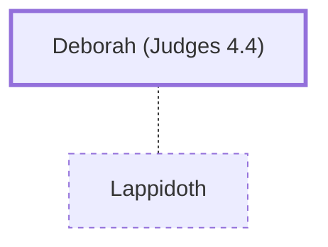

# Deborah (Judges 4.4)

Prophetess and judge who led Israel to victory over Canaanites.

**Original-language names:** דְּבוֹרָה (H1683)

## When

- **Placed around:** [[connections/timeline/13th century BC|1285 BC]] *(Ussher: the median date of the passages naming them)*

## Family

- **Spouses:** [[connections/people/Lappidoth|Lappidoth]]

## Events

- [[connections/timeline/13th century BC|1278 BC]] · [[connections/events/Deliverance by Barak And Deborah|Deliverance by Barak And Deborah]]

## Appears in

[[connections/chapters/07-judges/Judges 4|Judges 4 (5)]] · [[connections/chapters/07-judges/Judges 5|Judges 5 (4)]]

## Appears in the same verse as

[[connections/people/Barak|Barak (6)]] · [[connections/people/Israel|Israel (3)]] · [[connections/people/Abinoam|Abinoam (2)]] · [[connections/people/Sisera (Judges 4.2)|Sisera (Judges 4.2) (2)]] · [[connections/places/Kedesh|Kedesh (2)]] · [[connections/people/Ephraim|Ephraim]] · [[connections/people/Issachar (Genesis 30.18)|Issachar (Genesis 30.18)]] · [[connections/people/Lappidoth|Lappidoth]] · [[connections/people/Naphtali|Naphtali]] · [[connections/people/Reuben|Reuben]] · [[connections/people/Zebulun|Zebulun]] · [[connections/places/Bethel (Genesis 12.8)|Bethel (Genesis 12.8)]] · [[connections/places/Ramah (Joshua 18.25)|Ramah (Joshua 18.25)]] · [[connections/places/Tabor Mount|Tabor Mount]]
