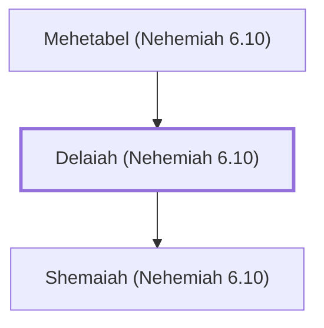

# Delaiah (Nehemiah 6.10)

Father of Shemaiah, who tried to deceive Nehemiah

**Original-language names:** דְּלָיָ֫הוּ (H1806)

## When

- **Placed around:** [[connections/timeline/5th century BC|445 BC]] *(Ussher: the median date of the passages naming them)*

## Family

- **Father:** [[connections/people/Mehetabel (Nehemiah 6.10)|Mehetabel (Nehemiah 6.10)]]
- **Children:** [[connections/people/Shemaiah (Nehemiah 6.10)|Shemaiah (Nehemiah 6.10)]]

**Family group:** [[connections/genealogy/Family of Mehetabel (Nehemiah 6.10)|Family of Mehetabel (Nehemiah 6.10)]], generation 2

## Appears in

[[connections/chapters/16-nehemiah/Nehemiah 6|Nehemiah 6]]

## Appears in the same verse as

[[connections/people/Mehetabel (Nehemiah 6.10)|Mehetabel (Nehemiah 6.10)]] · [[connections/people/Shemaiah (Nehemiah 6.10)|Shemaiah (Nehemiah 6.10)]]
