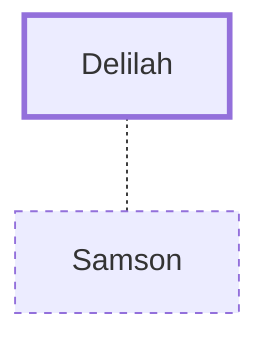

# Delilah

Philistine woman who betrayed Samson

**Original-language names:** דְּלִילָה (H1807)

## When

- **Placed around:** [[connections/timeline/12th century BC|1120 BC]] *(Ussher: the median date of the passages naming them)*

## Family

- **Spouses:** [[connections/people/Samson|Samson]]

## Appears in

[[connections/chapters/07-judges/Judges 16|Judges 16 (6)]]

## Appears in the same verse as

[[connections/people/Samson|Samson (4)]] · [[connections/places/Sorek Valley|Sorek Valley]]
