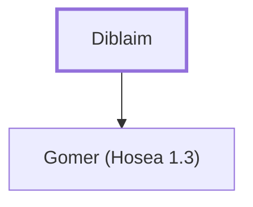

# Diblaim

Father of Gomer, Hosea's wife

**Original-language names:** דִּבְלַ֫יִם (H1691)

## When

- **Placed around:** [[connections/timeline/8th century BC|785 BC]] *(Ussher: the median date of the passages naming them)*

## Family

- **Children:** [[connections/people/Gomer (Hosea 1.3)|Gomer (Hosea 1.3)]]

**Family group:** [[connections/genealogy/Family of Beeri (Hosea 1.1)|Family of Beeri (Hosea 1.1)]], generation 1

## Appears in

[[connections/chapters/28-hosea/Hosea 1|Hosea 1]]

## Appears in the same verse as

[[connections/people/Gomer (Hosea 1.3)|Gomer (Hosea 1.3)]]
