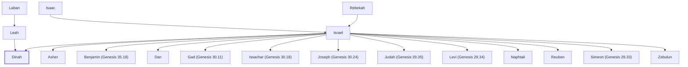

# Dinah

Daughter of Jacob and Leah

**Original-language names:** דִּינָה (H1783)

## When

- **Lived:** [[connections/timeline/18th century BC|1750 BC]] – ? *(Jones)*
- **Placed around:** [[connections/timeline/18th century BC|1732 BC]] *(Ussher: the median date of the passages naming them)*

## Family

- **Father:** [[connections/people/Israel|Israel]]
- **Mother:** [[connections/people/Leah|Leah]]
- **Brothers and sisters:** [[connections/people/Asher|Asher]], [[connections/people/Benjamin (Genesis 35.18)|Benjamin (Genesis 35.18)]], [[connections/people/Dan|Dan]], [[connections/people/Gad (Genesis 30.11)|Gad (Genesis 30.11)]], [[connections/people/Issachar (Genesis 30.18)|Issachar (Genesis 30.18)]], [[connections/people/Joseph (Genesis 30.24)|Joseph (Genesis 30.24)]], [[connections/people/Judah (Genesis 29.35)|Judah (Genesis 29.35)]], [[connections/people/Levi (Genesis 29.34)|Levi (Genesis 29.34)]], [[connections/people/Naphtali|Naphtali]], [[connections/people/Reuben|Reuben]], [[connections/people/Simeon (Genesis 29.33)|Simeon (Genesis 29.33)]], [[connections/people/Zebulun|Zebulun]]
- **Tribe or nation:** Early Patriarch

**Line of descent** (24 generations, father to son): [[connections/people/Adam|Adam]] → [[connections/people/Seth|Seth]] → [[connections/people/Enosh|Enosh]] → [[connections/people/Kenan|Kenan]] → [[connections/people/Mahalalel (Genesis 5.12)|Mahalalel (Genesis 5.12)]] → [[connections/people/Jared|Jared]] → [[connections/people/Enoch (Genesis 5.18)|Enoch (Genesis 5.18)]] → [[connections/people/Methuselah|Methuselah]] → [[connections/people/Lamech (Genesis 5.25)|Lamech (Genesis 5.25)]] → [[connections/people/Noah (Genesis 5.29)|Noah (Genesis 5.29)]] → [[connections/people/Shem|Shem]] → [[connections/people/Arpachshad|Arpachshad]] → [[connections/people/Cainan|Cainan]] → [[connections/people/Shelah (Genesis 10.24)|Shelah (Genesis 10.24)]] → [[connections/people/Eber (Genesis 10.21)|Eber (Genesis 10.21)]] → [[connections/people/Peleg|Peleg]] → [[connections/people/Reu|Reu]] → [[connections/people/Serug|Serug]] → [[connections/people/Nahor (Genesis 11.22)|Nahor (Genesis 11.22)]] → [[connections/people/Terah|Terah]] → [[connections/people/Abraham|Abraham]] → [[connections/people/Isaac|Isaac]] → [[connections/people/Israel|Israel]] → **Dinah**

**Family group:** [[connections/genealogy/Family of Adam|Family of Adam]], generation 24

## Events

- [[connections/timeline/18th century BC|1750 BC]] · [[connections/events/Birth of Dinah|Birth of Dinah]]

## Appears in

[[connections/chapters/01-genesis/Genesis 30|Genesis 30]] · [[connections/chapters/01-genesis/Genesis 34|Genesis 34 (6)]] · [[connections/chapters/01-genesis/Genesis 46|Genesis 46]]

## Appears in the same verse as

[[connections/people/Israel|Israel (6)]] · [[connections/people/Hamor|Hamor (2)]] · [[connections/people/Leah|Leah (2)]] · [[connections/people/Shechem (Genesis 33.19)|Shechem (Genesis 33.19) (2)]] · [[connections/people/Levi (Genesis 29.34)|Levi (Genesis 29.34)]] · [[connections/people/Simeon (Genesis 29.33)|Simeon (Genesis 29.33)]] · [[connections/places/Paddan|Paddan]]
