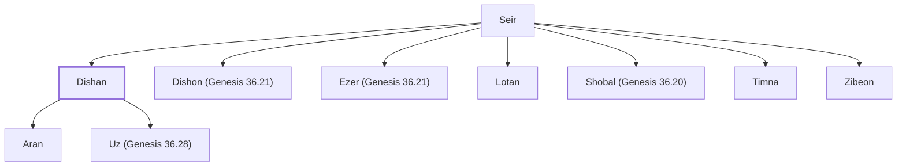

# Dishan

Descendant of Seir the Horite

**Also called:** Dishon

**Original-language names:** דִּישָׁן (H1789) · דִּישֹׁן (H1787)

## When

- **Placed around:** [[connections/timeline/18th century BC|1800 BC]] *(Ussher: the median date of the passages naming them)*

## Family

- **Father:** [[connections/people/Seir|Seir]]
- **Brothers and sisters:** [[connections/people/Dishon (Genesis 36.21)|Dishon (Genesis 36.21)]], [[connections/people/Ezer (Genesis 36.21)|Ezer (Genesis 36.21)]], [[connections/people/Lotan|Lotan]], [[connections/people/Shobal (Genesis 36.20)|Shobal (Genesis 36.20)]], [[connections/people/Timna|Timna]], [[connections/people/Zibeon|Zibeon]]
- **Children:** [[connections/people/Aran|Aran]], [[connections/people/Uz (Genesis 36.28)|Uz (Genesis 36.28)]]
- **Tribe or nation:** Edom

**Family group:** [[connections/genealogy/Family of Adam|Family of Adam]], generation 2

## Appears in

[[connections/chapters/01-genesis/Genesis 36|Genesis 36 (3)]] · [[connections/chapters/13-1-chronicles/1 Chronicles 1|1 Chronicles 1 (2)]]

## Appears in the same verse as

[[connections/people/Ezer (Genesis 36.21)|Ezer (Genesis 36.21) (4)]] · [[connections/people/Dishon (Genesis 36.21)|Dishon (Genesis 36.21) (3)]] · [[connections/people/Aran|Aran (2)]] · [[connections/people/Seir|Seir (2)]] · [[connections/people/Uz (Genesis 36.28)|Uz (Genesis 36.28) (2)]] · [[connections/people/Akan|Akan]] · [[connections/people/Anah|Anah]] · [[connections/people/Bilhan (Genesis 36.27)|Bilhan (Genesis 36.27)]] · [[connections/people/Esau|Esau]] · [[connections/people/Hori (Genesis 36.22)|Hori (Genesis 36.22)]] · [[connections/people/Lotan|Lotan]] · [[connections/people/Shobal (Genesis 36.20)|Shobal (Genesis 36.20)]] · [[connections/people/Zaavan|Zaavan]] · [[connections/places/Seir|Seir]]
