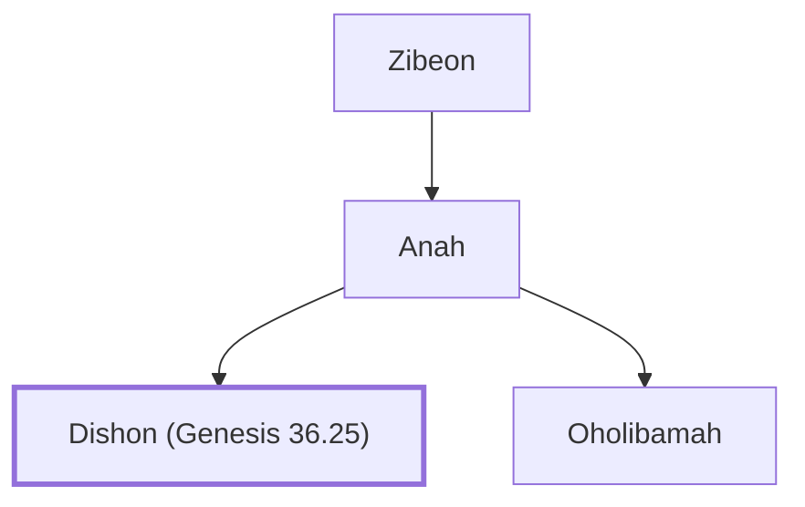

# Dishon (Genesis 36.25)

Grandson of Seir the Horite through Anah

**Original-language names:** דִּישֹׁן (H1787)

## When

- **Placed around:** [[connections/timeline/18th century BC|1756 BC]] *(Ussher: the median date of the passages naming them)*

## Family

- **Father:** [[connections/people/Anah|Anah]]
- **Brothers and sisters:** [[connections/people/Oholibamah|Oholibamah]]
- **Tribe or nation:** Edom

**Line of descent** (4 generations, father to son): [[connections/people/Seir|Seir]] → [[connections/people/Zibeon|Zibeon]] → [[connections/people/Anah|Anah]] → **Dishon (Genesis 36.25)**

**Family group:** [[connections/genealogy/Family of Adam|Family of Adam]], generation 4

## Appears in

[[connections/chapters/01-genesis/Genesis 36|Genesis 36]] · [[connections/chapters/13-1-chronicles/1 Chronicles 1|1 Chronicles 1]]

## Appears in the same verse as

[[connections/people/Anah|Anah (2)]] · [[connections/people/Cheran|Cheran]] · [[connections/people/Dishon (Genesis 36.21)|Dishon (Genesis 36.21)]] · [[connections/people/Eshban|Eshban]] · [[connections/people/Hemdan|Hemdan]] · [[connections/people/Ithran (Genesis 36.26)|Ithran (Genesis 36.26)]] · [[connections/people/Oholibamah|Oholibamah]]
