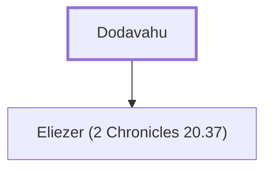

# Dodavahu

Prophet who rebuked Jehoshaphat for his alliance with Ahaziah

**Original-language names:** דּוֹדָוָהוּ (H1735)

## When

- **Placed around:** [[connections/timeline/9th century BC|896 BC]] *(Ussher: the median date of the passages naming them)*

## Family

- **Children:** [[connections/people/Eliezer (2 Chronicles 20.37)|Eliezer (2 Chronicles 20.37)]]

**Family group:** [[connections/genealogy/Family of Dodavahu|Family of Dodavahu]], generation 1

## Appears in

[[connections/chapters/14-2-chronicles/2 Chronicles 20|2 Chronicles 20]]

## Appears in the same verse as

[[connections/people/Ahaziah (1 Kings 22.40)|Ahaziah (1 Kings 22.40)]] · [[connections/people/Eliezer (2 Chronicles 20.37)|Eliezer (2 Chronicles 20.37)]] · [[connections/people/Jehoshaphat (1 Kings 15.24)|Jehoshaphat (1 Kings 15.24)]] · [[connections/places/Mareshah|Mareshah]] · [[connections/places/Tarshish|Tarshish]]
