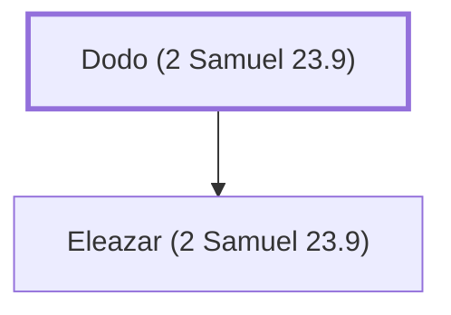

# Dodo (2 Samuel 23.9)

Father of Eleazar, one of David's mighty men

**Also called:** Dodai

**Original-language names:** דּוֹדוֹ (H1734) · דּוֹדַי (H1737)

## When

- **Placed around:** [[connections/timeline/11th century BC|1055 BC]] *(Ussher: the median date of the passages naming them)*

## Family

- **Children:** [[connections/people/Eleazar (2 Samuel 23.9)|Eleazar (2 Samuel 23.9)]]

**Family group:** [[connections/genealogy/Family of Dodo (2 Samuel 23.9)|Family of Dodo (2 Samuel 23.9)]], generation 1

## Appears in

[[connections/chapters/10-2-samuel/2 Samuel 23|2 Samuel 23]] · [[connections/chapters/13-1-chronicles/1 Chronicles 11|1 Chronicles 11]] · [[connections/chapters/13-1-chronicles/1 Chronicles 27|1 Chronicles 27]]

## Appears in the same verse as

[[connections/people/Eleazar (2 Samuel 23.9)|Eleazar (2 Samuel 23.9) (2)]] · [[connections/people/David|David]] · [[connections/people/Israel|Israel]] · [[connections/people/Mikloth (1 Chronicles 27.4)|Mikloth (1 Chronicles 27.4)]]
