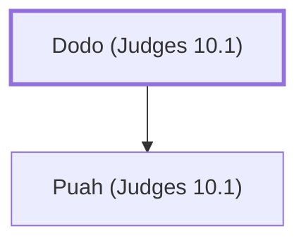

# Dodo (Judges 10.1)

Son of Puah, a judge of Israel

**Original-language names:** דּוֹדוֹ (H1734)

## When

- **Placed around:** [[connections/timeline/13th century BC|1232 BC]] *(Ussher: the median date of the passages naming them)*

## Family

- **Children:** [[connections/people/Puah (Judges 10.1)|Puah (Judges 10.1)]]

**Family group:** [[connections/genealogy/Family of Dodo (Judges 10.1)|Family of Dodo (Judges 10.1)]], generation 1

## Appears in

[[connections/chapters/07-judges/Judges 10|Judges 10]]

## Appears in the same verse as

[[connections/people/Abimelech (Judges 8.31)|Abimelech (Judges 8.31)]] · [[connections/people/Ephraim|Ephraim]] · [[connections/people/Israel|Israel]] · [[connections/people/Issachar (Genesis 30.18)|Issachar (Genesis 30.18)]] · [[connections/people/Puah (Judges 10.1)|Puah (Judges 10.1)]] · [[connections/people/Tola (Judges 10.1)|Tola (Judges 10.1)]] · [[connections/places/Shamir (Judges 10.1)|Shamir (Judges 10.1)]]
