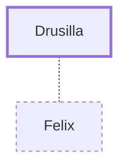

# Drusilla

Jewish wife of Felix, the Roman governor

**Original-language names:** Δρούσιλλα (G1409)

## When

- **Placed around:** [[connections/timeline/1st century AD|AD 60]] *(Ussher: the median date of the passages naming them)*

## Family

- **Spouses:** [[connections/people/Felix|Felix]]

## Events

- [[connections/timeline/1st century AD|AD 56]] · [[connections/events/Paul sent to Felix|Paul sent to Felix]]

## Appears in

[[connections/chapters/44-acts/Acts 24|Acts 24]]

## Appears in the same verse as

[[connections/people/Felix|Felix]] · [[connections/people/Jesus|Jesus]] · [[connections/people/Paul|Paul]]
