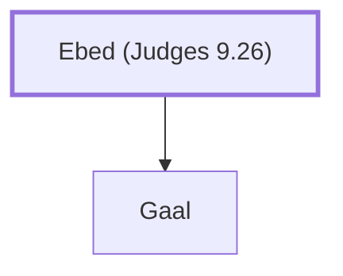

# Ebed (Judges 9.26)

Father of Gaal, who opposed Abimelech's rule

**Original-language names:** עֶ֫בֶד (H5651)

## When

- **Placed around:** [[connections/timeline/13th century BC|1233 BC]] *(Ussher: the median date of the passages naming them)*

## Family

- **Children:** [[connections/people/Gaal|Gaal]]

**Family group:** [[connections/genealogy/Family of Ebed (Judges 9.26)|Family of Ebed (Judges 9.26)]], generation 1

## Appears in

[[connections/chapters/07-judges/Judges 9|Judges 9 (5)]]

## Appears in the same verse as

[[connections/people/Gaal|Gaal (5)]] · [[connections/people/Abimelech (Judges 8.31)|Abimelech (Judges 8.31) (3)]] · [[connections/places/Shechem|Shechem (3)]] · [[connections/people/Zebul|Zebul (2)]] · [[connections/people/Gideon|Gideon]] · [[connections/people/Hamor|Hamor]]
