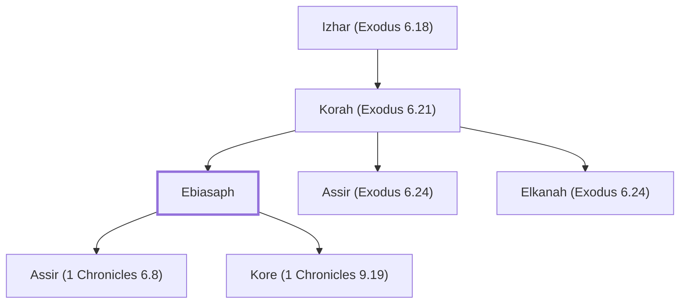

# Ebiasaph

Levite descendant of Korah, ancestor of temple gatekeepers

**Also called:** Abiasaph, Asaph

**Original-language names:** אֶבְיָסָף, אֲבִיאָסָף (H0043) · אֲבִיאָסָף (H0023) · אָסָף (H0623)

## When

- **Placed around:** [[connections/timeline/11th century BC|1042 BC]] *(Ussher: the median date of the passages naming them)*

## Family

- **Father:** [[connections/people/Korah (Exodus 6.21)|Korah (Exodus 6.21)]]
- **Brothers and sisters:** [[connections/people/Assir (Exodus 6.24)|Assir (Exodus 6.24)]], [[connections/people/Elkanah (Exodus 6.24)|Elkanah (Exodus 6.24)]]
- **Children:** [[connections/people/Assir (1 Chronicles 6.8)|Assir (1 Chronicles 6.8)]], [[connections/people/Kore (1 Chronicles 9.19)|Kore (1 Chronicles 9.19)]]
- **Tribe or nation:** Tribe of Levi

**Line of descent** (28 generations, father to son): [[connections/people/Adam|Adam]] → [[connections/people/Seth|Seth]] → [[connections/people/Enosh|Enosh]] → [[connections/people/Kenan|Kenan]] → [[connections/people/Mahalalel (Genesis 5.12)|Mahalalel (Genesis 5.12)]] → [[connections/people/Jared|Jared]] → [[connections/people/Enoch (Genesis 5.18)|Enoch (Genesis 5.18)]] → [[connections/people/Methuselah|Methuselah]] → [[connections/people/Lamech (Genesis 5.25)|Lamech (Genesis 5.25)]] → [[connections/people/Noah (Genesis 5.29)|Noah (Genesis 5.29)]] → [[connections/people/Shem|Shem]] → [[connections/people/Arpachshad|Arpachshad]] → [[connections/people/Cainan|Cainan]] → [[connections/people/Shelah (Genesis 10.24)|Shelah (Genesis 10.24)]] → [[connections/people/Eber (Genesis 10.21)|Eber (Genesis 10.21)]] → [[connections/people/Peleg|Peleg]] → [[connections/people/Reu|Reu]] → [[connections/people/Serug|Serug]] → [[connections/people/Nahor (Genesis 11.22)|Nahor (Genesis 11.22)]] → [[connections/people/Terah|Terah]] → [[connections/people/Abraham|Abraham]] → [[connections/people/Isaac|Isaac]] → [[connections/people/Israel|Israel]] → [[connections/people/Levi (Genesis 29.34)|Levi (Genesis 29.34)]] → [[connections/people/Kohath|Kohath]] → [[connections/people/Izhar (Exodus 6.18)|Izhar (Exodus 6.18)]] → [[connections/people/Korah (Exodus 6.21)|Korah (Exodus 6.21)]] → **Ebiasaph**

**Family group:** [[connections/genealogy/Family of Adam|Family of Adam]], generation 28

## Appears in

[[connections/chapters/02-exodus/Exodus 6|Exodus 6]] · [[connections/chapters/13-1-chronicles/1 Chronicles 6|1 Chronicles 6 (2)]] · [[connections/chapters/13-1-chronicles/1 Chronicles 9|1 Chronicles 9]] · [[connections/chapters/13-1-chronicles/1 Chronicles 26|1 Chronicles 26]]

## Appears in the same verse as

[[connections/people/Korah (Exodus 6.21)|Korah (Exodus 6.21) (3)]] · [[connections/people/Assir (1 Chronicles 6.8)|Assir (1 Chronicles 6.8) (2)]] · [[connections/people/Elkanah (Exodus 6.24)|Elkanah (Exodus 6.24) (2)]] · [[connections/people/Kore (1 Chronicles 9.19)|Kore (1 Chronicles 9.19) (2)]] · [[connections/people/Assir (Exodus 6.24)|Assir (Exodus 6.24)]] · [[connections/people/Meshelemiah|Meshelemiah]] · [[connections/people/Shallum (1 Chronicles 9.17)|Shallum (1 Chronicles 9.17)]] · [[connections/people/Tahath (1 Chronicles 6.9)|Tahath (1 Chronicles 6.9)]]
