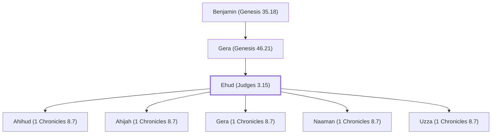

# Ehud (Judges 3.15)

Left-handed Benjamite judge who delivered Israel from Moabite oppression

**Original-language names:** אֵהוּד (H0164) · אֵחוּד (H0261)

## When

- **Placed around:** [[connections/timeline/14th century BC|1325 BC]] *(Ussher: the median date of the passages naming them)*

## Family

- **Father:** [[connections/people/Gera (Genesis 46.21)|Gera (Genesis 46.21)]]
- **Children:** [[connections/people/Ahihud (1 Chronicles 8.7)|Ahihud (1 Chronicles 8.7)]], [[connections/people/Ahijah (1 Chronicles 8.7)|Ahijah (1 Chronicles 8.7)]], [[connections/people/Gera (1 Chronicles 8.7)|Gera (1 Chronicles 8.7)]], [[connections/people/Naaman (1 Chronicles 8.7)|Naaman (1 Chronicles 8.7)]], [[connections/people/Uzza (1 Chronicles 8.7)|Uzza (1 Chronicles 8.7)]]
- **Tribe or nation:** Tribe of Benjamin

**Line of descent** (26 generations, father to son): [[connections/people/Adam|Adam]] → [[connections/people/Seth|Seth]] → [[connections/people/Enosh|Enosh]] → [[connections/people/Kenan|Kenan]] → [[connections/people/Mahalalel (Genesis 5.12)|Mahalalel (Genesis 5.12)]] → [[connections/people/Jared|Jared]] → [[connections/people/Enoch (Genesis 5.18)|Enoch (Genesis 5.18)]] → [[connections/people/Methuselah|Methuselah]] → [[connections/people/Lamech (Genesis 5.25)|Lamech (Genesis 5.25)]] → [[connections/people/Noah (Genesis 5.29)|Noah (Genesis 5.29)]] → [[connections/people/Shem|Shem]] → [[connections/people/Arpachshad|Arpachshad]] → [[connections/people/Cainan|Cainan]] → [[connections/people/Shelah (Genesis 10.24)|Shelah (Genesis 10.24)]] → [[connections/people/Eber (Genesis 10.21)|Eber (Genesis 10.21)]] → [[connections/people/Peleg|Peleg]] → [[connections/people/Reu|Reu]] → [[connections/people/Serug|Serug]] → [[connections/people/Nahor (Genesis 11.22)|Nahor (Genesis 11.22)]] → [[connections/people/Terah|Terah]] → [[connections/people/Abraham|Abraham]] → [[connections/people/Isaac|Isaac]] → [[connections/people/Israel|Israel]] → [[connections/people/Benjamin (Genesis 35.18)|Benjamin (Genesis 35.18)]] → [[connections/people/Gera (Genesis 46.21)|Gera (Genesis 46.21)]] → **Ehud (Judges 3.15)**

**Family group:** [[connections/genealogy/Family of Adam|Family of Adam]], generation 26

## Events

- [[connections/timeline/14th century BC|1360 BC]] · [[connections/events/Deliverance by Ehud|Deliverance by Ehud]]

## Appears in

[[connections/chapters/07-judges/Judges 3|Judges 3 (6)]] · [[connections/chapters/07-judges/Judges 4|Judges 4]] · [[connections/chapters/13-1-chronicles/1 Chronicles 8|1 Chronicles 8]]

## Appears in the same verse as

[[connections/people/Israel|Israel (2)]] · [[connections/people/Eglon|Eglon]] · [[connections/people/Gera (Genesis 46.21)|Gera (Genesis 46.21)]] · [[connections/places/Geba|Geba]] · [[connections/places/Manahath|Manahath]] · [[connections/places/Moab|Moab]] · [[connections/places/Seirah|Seirah]]
