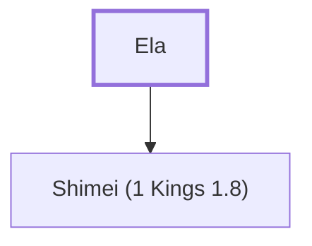

# Ela

Son of Uzzi, an official under Solomon

**Original-language names:** אֵלָא (H0414)

## When

- **Placed around:** [[connections/timeline/11th century BC|1014 BC]] *(Ussher: the median date of the passages naming them)*

## Family

- **Children:** [[connections/people/Shimei (1 Kings 1.8)|Shimei (1 Kings 1.8)]]

**Family group:** [[connections/genealogy/Family of Ela|Family of Ela]], generation 1

## Appears in

[[connections/chapters/11-1-kings/1 Kings 4|1 Kings 4]]

## Appears in the same verse as

[[connections/people/Benjamin (Genesis 35.18)|Benjamin (Genesis 35.18)]] · [[connections/people/Shimei (1 Kings 1.8)|Shimei (1 Kings 1.8)]]
