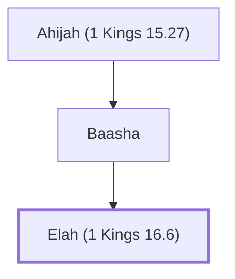

# Elah (1 Kings 16.6)

Son of Baasha, king of Israel

**Original-language names:** אֵלָה (H0425)

## When

- **Placed around:** [[connections/timeline/10th century BC|929 BC]] *(Ussher: the median date of the passages naming them)*

## Family

- **Father:** [[connections/people/Baasha|Baasha]]
- **Tribe or nation:** Israel

**Line of descent** (3 generations, father to son): [[connections/people/Ahijah (1 Kings 15.27)|Ahijah (1 Kings 15.27)]] → [[connections/people/Baasha|Baasha]] → **Elah (1 Kings 16.6)**

**Family group:** [[connections/genealogy/Family of Ahijah (1 Kings 15.27)|Family of Ahijah (1 Kings 15.27)]], generation 3

## Events

- [[connections/timeline/10th century BC|930 BC]] · [[connections/events/Reign of Elah|Reign of Elah]]

## Appears in

[[connections/chapters/11-1-kings/1 Kings 16|1 Kings 16 (4)]]

## Appears in the same verse as

[[connections/people/Baasha|Baasha (3)]] · [[connections/people/Israel|Israel (3)]] · [[connections/places/Tirzah|Tirzah (2)]] · [[connections/people/Asa (1 Kings 15.8)|Asa (1 Kings 15.8)]] · [[connections/people/Judah (Genesis 29.35)|Judah (Genesis 29.35)]]
