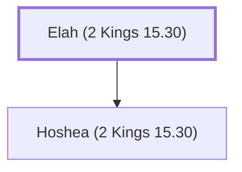

# Elah (2 Kings 15.30)

Father of Hoshea, the last king of Israel

**Original-language names:** אֵלָה (H0425)

## When

- **Placed around:** [[connections/timeline/8th century BC|726 BC]] *(Ussher: the median date of the passages naming them)*

## Family

- **Children:** [[connections/people/Hoshea (2 Kings 15.30)|Hoshea (2 Kings 15.30)]]

**Family group:** [[connections/genealogy/Family of Elah (2 Kings 15.30)|Family of Elah (2 Kings 15.30)]], generation 1

## Appears in

[[connections/chapters/12-2-kings/2 Kings 15|2 Kings 15]] · [[connections/chapters/12-2-kings/2 Kings 17|2 Kings 17]] · [[connections/chapters/12-2-kings/2 Kings 18|2 Kings 18 (2)]]

## Appears in the same verse as

[[connections/people/Hoshea (2 Kings 15.30)|Hoshea (2 Kings 15.30) (4)]] · [[connections/people/Israel|Israel (3)]] · [[connections/people/Ahaz (2 Kings 15.38)|Ahaz (2 Kings 15.38) (2)]] · [[connections/people/Hezekiah (2 Kings 16.20)|Hezekiah (2 Kings 16.20) (2)]] · [[connections/people/Judah (Genesis 29.35)|Judah (Genesis 29.35) (2)]] · [[connections/places/Samaria|Samaria (2)]] · [[connections/people/Jotham (2 Kings 15.5)|Jotham (2 Kings 15.5)]] · [[connections/people/Pekah|Pekah]] · [[connections/people/Remaliah|Remaliah]] · [[connections/people/Shalmaneser|Shalmaneser]] · [[connections/people/Uzziah (2 Kings 14.21)|Uzziah (2 Kings 14.21)]] · [[connections/places/Assyria|Assyria]]
