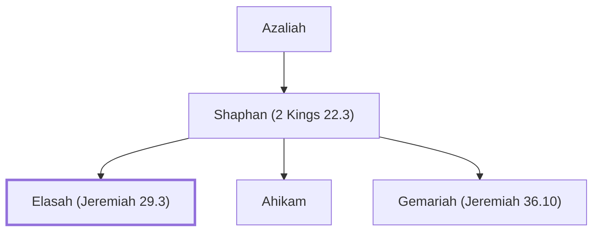

# Elasah (Jeremiah 29.3)

Messenger who carried Jeremiah's letter to the exiles

**Original-language names:** אֶלְעָשָׂה (H0501)

## When

- **Placed around:** [[connections/timeline/6th century BC|599 BC]] *(Ussher: the median date of the passages naming them)*

## Family

- **Father:** [[connections/people/Shaphan (2 Kings 22.3)|Shaphan (2 Kings 22.3)]]
- **Brothers and sisters:** [[connections/people/Ahikam|Ahikam]], [[connections/people/Gemariah (Jeremiah 36.10)|Gemariah (Jeremiah 36.10)]]

**Line of descent** (4 generations, father to son): [[connections/people/Meshullam (2 Kings 22.3)|Meshullam (2 Kings 22.3)]] → [[connections/people/Azaliah|Azaliah]] → [[connections/people/Shaphan (2 Kings 22.3)|Shaphan (2 Kings 22.3)]] → **Elasah (Jeremiah 29.3)**

**Family group:** [[connections/genealogy/Family of Meshullam (2 Kings 22.3)|Family of Meshullam (2 Kings 22.3)]], generation 4

## Appears in

[[connections/chapters/24-jeremiah/Jeremiah 29|Jeremiah 29]]

## Appears in the same verse as

[[connections/people/Gemariah (Jeremiah 29.3)|Gemariah (Jeremiah 29.3)]] · [[connections/people/Hilkiah (2 Kings 22.4)|Hilkiah (2 Kings 22.4)]] · [[connections/people/Judah (Genesis 29.35)|Judah (Genesis 29.35)]] · [[connections/people/Nebuchadnezzar|Nebuchadnezzar]] · [[connections/people/Shaphan (2 Kings 22.3)|Shaphan (2 Kings 22.3)]] · [[connections/people/Zedekiah (2 Kings 24.17)|Zedekiah (2 Kings 24.17)]] · [[connections/places/Babylon|Babylon]]
