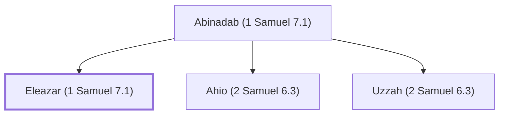

# Eleazar (1 Samuel 7.1)

Son of Abinadab, consecrated to keep the ark

**Original-language names:** אֶלְעָזָר (H0499)

## Family

- **Father:** [[connections/people/Abinadab (1 Samuel 7.1)|Abinadab (1 Samuel 7.1)]]
- **Brothers and sisters:** [[connections/people/Ahio (2 Samuel 6.3)|Ahio (2 Samuel 6.3)]], [[connections/people/Uzzah (2 Samuel 6.3)|Uzzah (2 Samuel 6.3)]]

**Family group:** [[connections/genealogy/Family of Abinadab (1 Samuel 7.1)|Family of Abinadab (1 Samuel 7.1)]], generation 2

## Appears in

[[connections/chapters/09-1-samuel/1 Samuel 7|1 Samuel 7]]

## Appears in the same verse as

[[connections/people/Abinadab (1 Samuel 7.1)|Abinadab (1 Samuel 7.1)]] · [[connections/places/Kiriath-jearim|Kiriath-jearim]]
