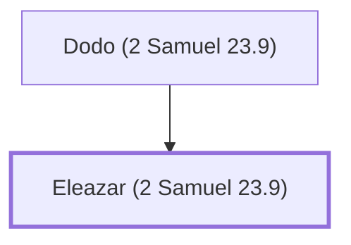

# Eleazar (2 Samuel 23.9)

Son of Dodo, one of David's mighty men

**Original-language names:** אֶלְעָזָר (H0499)

## When

- **Placed around:** [[connections/timeline/11th century BC|1055 BC]] *(Ussher: the median date of the passages naming them)*

## Family

- **Father:** [[connections/people/Dodo (2 Samuel 23.9)|Dodo (2 Samuel 23.9)]]

**Family group:** [[connections/genealogy/Family of Dodo (2 Samuel 23.9)|Family of Dodo (2 Samuel 23.9)]], generation 2

## Appears in

[[connections/chapters/10-2-samuel/2 Samuel 23|2 Samuel 23]] · [[connections/chapters/13-1-chronicles/1 Chronicles 11|1 Chronicles 11]]

## Appears in the same verse as

[[connections/people/Dodo (2 Samuel 23.9)|Dodo (2 Samuel 23.9) (2)]] · [[connections/people/David|David]] · [[connections/people/Israel|Israel]]
