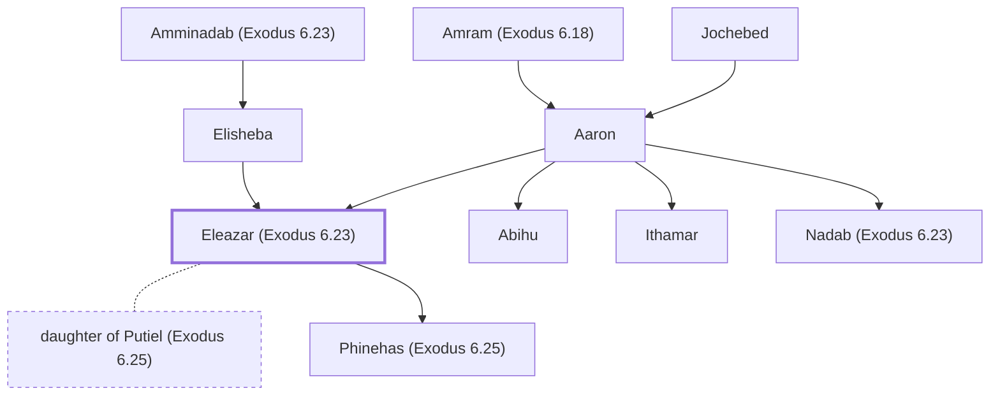

# Eleazar (Exodus 6.23)

Son of Aaron, high priest after his father

**Original-language names:** אֶלְעָזָר (H0499)

## When

- **Placed around:** [[connections/timeline/15th century BC|1452 BC]] *(Ussher: the median date of the passages naming them)*

## Family

- **Father:** [[connections/people/Aaron|Aaron]]
- **Mother:** [[connections/people/Elisheba|Elisheba]]
- **Brothers and sisters:** [[connections/people/Abihu|Abihu]], [[connections/people/Ithamar|Ithamar]], [[connections/people/Nadab (Exodus 6.23)|Nadab (Exodus 6.23)]]
- **Spouses:** [[connections/people/daughter of Putiel (Exodus 6.25)|daughter of Putiel (Exodus 6.25)]]
- **Children:** [[connections/people/Phinehas (Exodus 6.25)|Phinehas (Exodus 6.25)]]
- **Tribe or nation:** Tribe of Levi

**Line of descent** (28 generations, father to son): [[connections/people/Adam|Adam]] → [[connections/people/Seth|Seth]] → [[connections/people/Enosh|Enosh]] → [[connections/people/Kenan|Kenan]] → [[connections/people/Mahalalel (Genesis 5.12)|Mahalalel (Genesis 5.12)]] → [[connections/people/Jared|Jared]] → [[connections/people/Enoch (Genesis 5.18)|Enoch (Genesis 5.18)]] → [[connections/people/Methuselah|Methuselah]] → [[connections/people/Lamech (Genesis 5.25)|Lamech (Genesis 5.25)]] → [[connections/people/Noah (Genesis 5.29)|Noah (Genesis 5.29)]] → [[connections/people/Shem|Shem]] → [[connections/people/Arpachshad|Arpachshad]] → [[connections/people/Cainan|Cainan]] → [[connections/people/Shelah (Genesis 10.24)|Shelah (Genesis 10.24)]] → [[connections/people/Eber (Genesis 10.21)|Eber (Genesis 10.21)]] → [[connections/people/Peleg|Peleg]] → [[connections/people/Reu|Reu]] → [[connections/people/Serug|Serug]] → [[connections/people/Nahor (Genesis 11.22)|Nahor (Genesis 11.22)]] → [[connections/people/Terah|Terah]] → [[connections/people/Abraham|Abraham]] → [[connections/people/Isaac|Isaac]] → [[connections/people/Israel|Israel]] → [[connections/people/Levi (Genesis 29.34)|Levi (Genesis 29.34)]] → [[connections/people/Kohath|Kohath]] → [[connections/people/Amram (Exodus 6.18)|Amram (Exodus 6.18)]] → [[connections/people/Aaron|Aaron]] → **Eleazar (Exodus 6.23)**

**Family group:** [[connections/genealogy/Family of Adam|Family of Adam]], generation 28

## Appears in

[[connections/chapters/02-exodus/Exodus 6|Exodus 6 (2)]] · [[connections/chapters/02-exodus/Exodus 28|Exodus 28]] · [[connections/chapters/03-leviticus/Leviticus 10|Leviticus 10 (3)]] · [[connections/chapters/04-numbers/Numbers 3|Numbers 3 (3)]] · [[connections/chapters/04-numbers/Numbers 4|Numbers 4]] · [[connections/chapters/04-numbers/Numbers 17|Numbers 17 (2)]] · [[connections/chapters/04-numbers/Numbers 19|Numbers 19 (2)]] · [[connections/chapters/04-numbers/Numbers 20|Numbers 20 (3)]] · [[connections/chapters/04-numbers/Numbers 25|Numbers 25 (3)]] · [[connections/chapters/04-numbers/Numbers 26|Numbers 26 (3)]] · [[connections/chapters/04-numbers/Numbers 27|Numbers 27 (4)]] · [[connections/chapters/04-numbers/Numbers 31|Numbers 31 (10)]] · [[connections/chapters/04-numbers/Numbers 32|Numbers 32 (2)]] · [[connections/chapters/04-numbers/Numbers 34|Numbers 34]] · [[connections/chapters/05-deuteronomy/Deuteronomy 10|Deuteronomy 10]] · [[connections/chapters/06-joshua/Joshua 14|Joshua 14]] · [[connections/chapters/06-joshua/Joshua 17|Joshua 17]] · [[connections/chapters/06-joshua/Joshua 19|Joshua 19]] · [[connections/chapters/06-joshua/Joshua 21|Joshua 21]] · [[connections/chapters/06-joshua/Joshua 22|Joshua 22 (3)]] · [[connections/chapters/06-joshua/Joshua 24|Joshua 24]] · [[connections/chapters/07-judges/Judges 20|Judges 20]] · [[connections/chapters/13-1-chronicles/1 Chronicles 5|1 Chronicles 5 (2)]] · [[connections/chapters/13-1-chronicles/1 Chronicles 6|1 Chronicles 6]] · [[connections/chapters/13-1-chronicles/1 Chronicles 9|1 Chronicles 9]] · [[connections/chapters/13-1-chronicles/1 Chronicles 24|1 Chronicles 24 (6)]] · [[connections/chapters/15-ezra/Ezra 7|Ezra 7]]

## Appears in the same verse as

[[connections/people/Aaron|Aaron (25)]] · [[connections/people/Moses|Moses (21)]] · [[connections/people/Israel|Israel (15)]] · [[connections/people/Ithamar|Ithamar (15)]] · [[connections/people/Phinehas (Exodus 6.25)|Phinehas (Exodus 6.25) (13)]] · [[connections/people/Abihu|Abihu (8)]] · [[connections/people/Nadab (Exodus 6.23)|Nadab (Exodus 6.23) (8)]] · [[connections/people/Joshua (Exodus 17.9)|Joshua (Exodus 17.9) (7)]] · [[connections/people/Nun|Nun (6)]] · [[connections/people/Gad (Genesis 30.11)|Gad (Genesis 30.11) (4)]] · [[connections/people/Reuben|Reuben (4)]] · [[connections/people/Abishua (1 Chronicles 5.30)|Abishua (1 Chronicles 5.30) (3)]] · [[connections/places/Jericho|Jericho (3)]] · [[connections/places/Jordan|Jordan (3)]] · [[connections/places/Moab Plains|Moab Plains (3)]] · [[connections/people/Ahimelech (2 Samuel 8.17)|Ahimelech (2 Samuel 8.17) (2)]] · [[connections/people/Manasseh (Genesis 41.51)|Manasseh (Genesis 41.51) (2)]] · [[connections/people/Zadok (2 Samuel 8.17)|Zadok (2 Samuel 8.17) (2)]] · [[connections/places/Canaan|Canaan (2)]] · [[connections/places/Gilead|Gilead (2)]] · [[connections/people/Abiathar|Abiathar]] · [[connections/people/Amminadab (Exodus 6.23)|Amminadab (Exodus 6.23)]] · [[connections/people/Amram (Exodus 6.18)|Amram (Exodus 6.18)]] · [[connections/people/Benjamin (Genesis 35.18)|Benjamin (Genesis 35.18)]] · [[connections/people/David|David]] · [[connections/people/Elisheba|Elisheba]] · [[connections/people/Ephraim|Ephraim]] · [[connections/people/Miriam (Exodus 15.20)|Miriam (Exodus 15.20)]] · [[connections/people/Nahshon|Nahshon]] · [[connections/people/Nethanel (1 Chronicles 24.6)|Nethanel (1 Chronicles 24.6)]] · [[connections/people/Putiel|Putiel]] · [[connections/people/Shemaiah (1 Chronicles 24.6)|Shemaiah (1 Chronicles 24.6)]] · [[connections/places/Bene-jaakan|Bene-jaakan]] · [[connections/places/Gibeah (Joshua 18.28)|Gibeah (Joshua 18.28)]] · [[connections/places/Hor Mount|Hor Mount]] · [[connections/places/Moserah|Moserah]] · [[connections/places/Shiloh|Shiloh]] · [[connections/places/Sinai Wilderness|Sinai Wilderness]]
